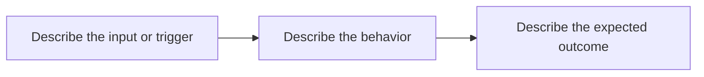

## Objective

<!-- What outcome should this issue deliver? -->

## Context

<!-- Why is this needed? Include affected users, current behavior, and constraints.
For bugs, include reproduction steps and expected versus actual behavior. -->

## Tasks

- [ ] Describe the implementation work.
- [ ] Add or update the diagrams and relevant documentation.
- [ ] Verify the acceptance criteria and record the results.

## Acceptance Criteria

<!-- Replace these prompts with observable, testable outcomes. -->

- [ ] The intended behavior can be demonstrated.
- [ ] Relevant checks pass and evidence is linked.

## Diagrams

Include **at least one** Mermaid diagram or linked draw.io `.drawio.svg` diagram.
Choose a flowchart, UML, ER, architecture, or sequence/activity diagram that
explains this issue. Replace the starter below with the actual flow; update it
as the design changes. Link the maintained diagram in `docs/` when applicable.

## Related

<!-- Link related issues, dependencies, PRs, docs, and designs. For cross-repo
issues, use SFI-Foundation/Backend#<number> or a full URL. -->

<!-- During triage: add area/type labels, exactly one of P1/P2/P3, the agreed
sprint milestone, and a confirmed responsible assignee. See docs/sprint-workflow.md. -->
