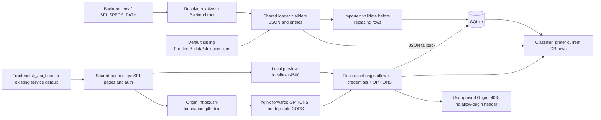

**Community partner introduction, SFI contacts, and October 2026 conversation microblog:** [SFI Partnership Log]({{ '/capstone/sfi-partnership/' | relative_url }}).

## Team and ownership

**Scrum Masters:** Ruhaan Bansal (@ruhaanb622), Ishan Jha (@Jupiterian).

**Developers:** Arya Taghavi Zargar (@aRYA622-y), Ishan Khandelwal (@Grazer01LA),
Deyar Raissadat (@DrDeyar), Vayun Shekhar (@Droidsector23).

Ruhaan Bansal is accountable for this setup issue (Medium priority).

[Frontend repository](https://github.com/SFI-Foundation/Frontend) ·
[Backend repository](https://github.com/SFI-Foundation/Backend) ·
[KanBan board](https://github.com/orgs/SFI-Foundation/projects/1) ·
[Issue #7](https://github.com/SFI-Foundation/Frontend/issues/7)

## Teammate setup and system flow

Follow the [README quick start](https://github.com/SFI-Foundation/Frontend#quick-start-clone--install--run).
The updated diagram describes the Backend #8 companion feature branches;
review and deployment are pending. Frontend PR #16 was verified merged on
2026-10-23. Backend #8 is owned by @ruhaanb622 at High priority.

The disposable sibling-clone check imported 140 specs without a compatibility
symlink. The importer validates the source before replacing rows; classifier
retraining prefers current DB rows. Backend `.env` is repository-relative;
`SFI_SPECS_PATH` overrides the default, with relative paths anchored at Backend.
Database initialization is only for disposable data; existing databases need
no migration for this feature. Frontend `sfi_api_base` makes a confirmed future
service configurable while retaining the current default. Production API/CORS
and credential-cookie verification remain pending.

## Delivery and review

Quick Issue stages on the current board map to **Progress** (In Progress),
**Integration (PR)** (In Review), then deployment/system-test evidence. Retain
commands, logs, Key Commits, and the PR in issue #7. The site workflow deploys
main, so production deployment of this feature requires later review and merge.

Presentation, stakeholder acceptance, a teammate's fresh-clone walkthrough,
production API/CORS integration, and production delivery are pending. This page
does not claim those requirements are complete. The original
[Greppers prototype review]({{ '/capstone/greppers/' | relative_url }}) is kept
as historical capstone documentation.
