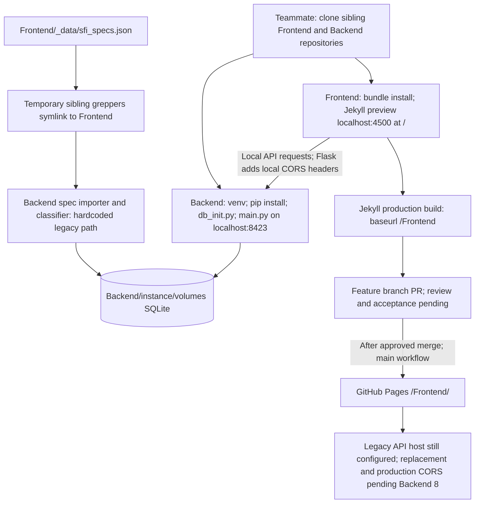

## Team and ownership

Ruhaan (@ruhaanb622), Ishan J (@Jupiterian), Arya (@aRYA622-y),
Deyar (@DrDeyar), Ishan K (@Grazer01LA), and Vayun Shekhar (@Droidsector23)
contribute development. Two Scrum Master assignments await team confirmation.
Ruhaan is accountable for this setup issue (Medium priority).

[Frontend repository](https://github.com/SFI-Foundation/Frontend) ·
[Backend repository](https://github.com/SFI-Foundation/Backend) ·
[KanBan board](https://github.com/orgs/SFI-Foundation/projects/1) ·
[Issue #7](https://github.com/SFI-Foundation/Frontend/issues/7)

## Teammate setup and system flow

Follow the [README quick start](https://github.com/SFI-Foundation/Frontend#quick-start-clone--install--run).
The diagram describes Backend main `31ad1151c2140aa77d2a45d7c6561920ef360317`;
[Backend #8](https://github.com/SFI-Foundation/Backend/issues/8) is still open.

The backend reads the frontend JSON, then stores specs in SQLite. It does not
serve the JSON directly from Jekyll. No spec-path environment variable is
implemented in the inspected backend. The temporary alias is needed until #8
lands; do not create it over an existing directory. Database initialization is
for a disposable local database because it can drop existing tables.

## Delivery and review

Quick Issue stages on the current board map to **Progress** (In Progress),
**Integration (PR)** (In Review), then deployment/system-test evidence. Retain
commands, logs, Key Commits, and the PR in issue #7. The site workflow deploys
main, so production deployment of this feature requires later review and merge.

Presentation, stakeholder acceptance, a teammate's fresh-clone walkthrough,
production API/CORS integration, and production delivery are pending. This page
does not claim those requirements are complete. The original
[Greppers prototype review]({{ '/capstone/greppers/' | relative_url }}) is kept
as historical capstone documentation.
