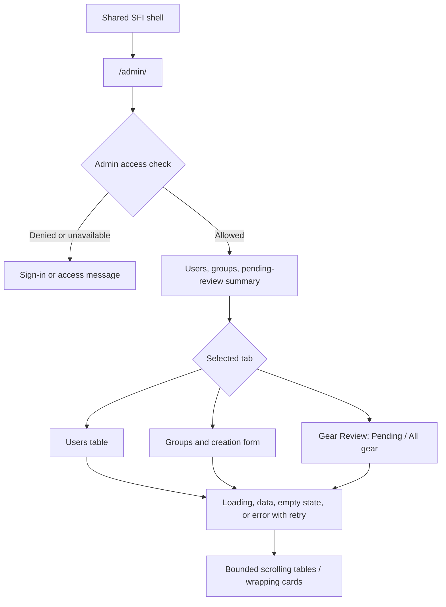

# Admin dashboard layout

Frontend #2 uses the existing `_layouts/sfi.html` shell for navigation, footer,
chatbot, and skip link. Styles compile through `assets/css/sfi.scss` and
`_sass/sfi/_main.scss`; dashboard rules live in `_sass/sfi/pages/_admin.scss`.
The former `_includes/sfi/styles.html` was removed by the Sass migration.

## Problem and design

An SFI administrator needs to understand account, group, and review activity
quickly and complete tasks on a phone. The previous four-tab layout split gear
work across two top-level destinations. How might we make users, groups, and gear
review easy to find and act on at any screen size using SFI's shared visual system?

The approved design has three top-level tabs: Users, Groups, and Gear Review.
Gear Review contains a labeled Pending reviews / All gear selector, preserving
both existing views. Users is selected initially. An alternative desktop sidebar
would keep destinations visible but reduce table width and require a different
mobile navigation pattern. Three tabs require fewer layout changes; All gear
requires one additional selection. This is a design rationale based on code and
issue inspection, not interview or usability-review evidence.

`navigation/admin.md` holds markup; `assets/js/sfi/admin.js` handles the existing
API calls, rendering, tab navigation, and gear view selection. It uses
`window.SFI_API_BASE` from the existing shared API configuration. Arrow keys,
Home, and End switch tabs and synchronize focus, selected state, and tab stops.
Only one top-level panel and one gear view are displayed at a time.

Summary cards show loaded users, groups, and pending reviews. Loading/unavailable
counts use an em dash; successful empty responses show zero and explicit messages.
Section failures offer a retry button. Counts refresh through the existing group
creation and gear review reloads. Tables have column headers and labeled,
keyboard-focusable scrolling regions. Group cards and long values wrap; controls
have a 44px minimum touch target. At phone widths, summary cards stack.



## Dependencies and limits

- Backend #1: agree on authorization and response shapes for `/me`, `/users`, and
  `/groups`. Existing code expects `me.isAdmin` and `user.groups[]`; the issue
  specifies `role` and a group field. Existing group detail, membership, deletion,
  and permission operations exceed the issue's listed endpoint scope.
- Frontend #1: this change extracts `admin.js` and reuses shared API configuration
  to provide one implementation location. User search, gear count, role contract
  alignment, and logged-out login redirection remain its integration work. The
  current sign-in/access gate is preserved.
- Frontend #3, Backend #3/#4: the existing `PATCH /gear/<id>/status` action with
  `note` is preserved. Frontend #3 specifies `PUT /gear/<id>/review` and reviewer
  notes; settle that contract before changing review behavior.
- Frontend #6: coordinate shared responsive changes. This implementation confines
  styling changes to the admin partial and leaves the shared shell intact.

Frontend gating does not replace backend authorization. Summary counts currently
use array lengths and assume complete, unpaginated responses. No live API success
or user research is claimed by the fixture tests.

## Acceptance and verification

At 375px, summary cards stack; tabs and forms fit or wrap; wide tables scroll
inside their own regions. At 768px and 1440px, summary cards share a row; group
cards wrap and controls fit. At 1440px the dashboard retains its centered 1100px
maximum width. At every width, document scroll width must not exceed viewport
width, including with long user, group, and gear names.

Exactly one top-level panel is visible. Keyboard navigation must synchronize tab
selection/focus; both gear views must remain accessible. Empty results must show
zero and explicit messages; failed loads must show unavailable counts and retry.
Denied access must leave admin content hidden. Successful mutations must refresh
related counts and content when verified against the agreed backend API.

Verification performed for this change:

- Sass compilation of the public theme and a minimal Jekyll build using the actual
  admin page, shared layout/includes, and JavaScript passed.
- `scripts/test-sfi-admin.mjs` passed 12 fixture scenarios: populated long values,
  empty data, failed request/retry, and denied access at 375px, 768px, and 1440px.
  Checks include no page overflow in all three panels, gear view switching,
  keyboard selection, empty/error counts, and no JavaScript exceptions.
- JavaScript syntax and `git diff --check` passed.

Run the focused browser check against a built site with:

```sh
PLAYWRIGHT_MODULE=/path/to/playwright node scripts/test-sfi-admin.mjs /path/to/built-site
```

Set `CHROME_PATH` if using an installed Chrome executable. Requests are intercepted
with fixtures; the test does not contact production or mutate production records.
A full repository build and live backend mutation/authorization round trip were
not performed in this layout pass.
