# Before and after comparisons

Captured from the pinned baseline and proposed production builds using isolated Chromium/Flask fixtures. Catalog rows and accounts are explicitly synthetic QA data, never client records. Photos and organization content are unchanged.

## Home

| Before | After |
|---|---|
| 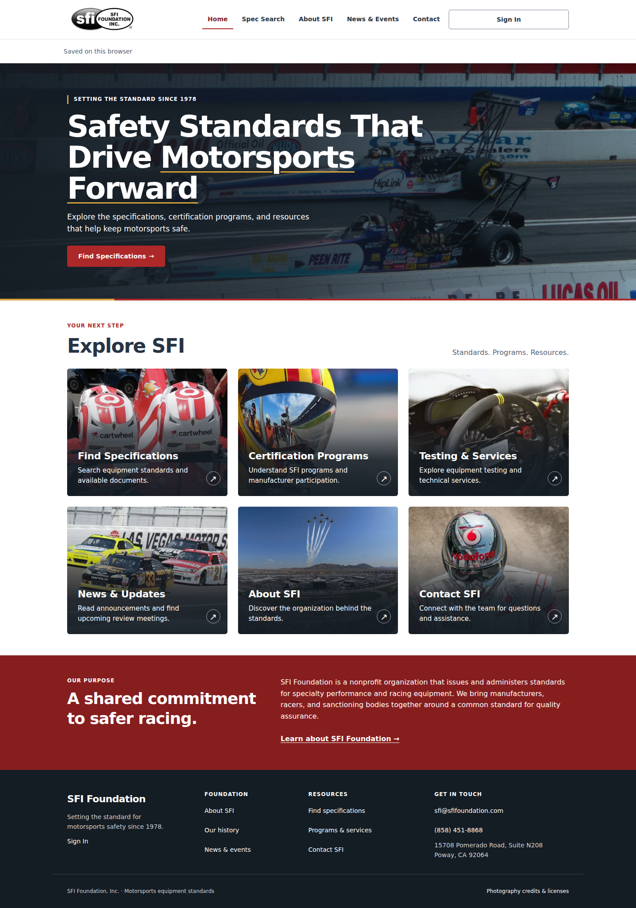 | 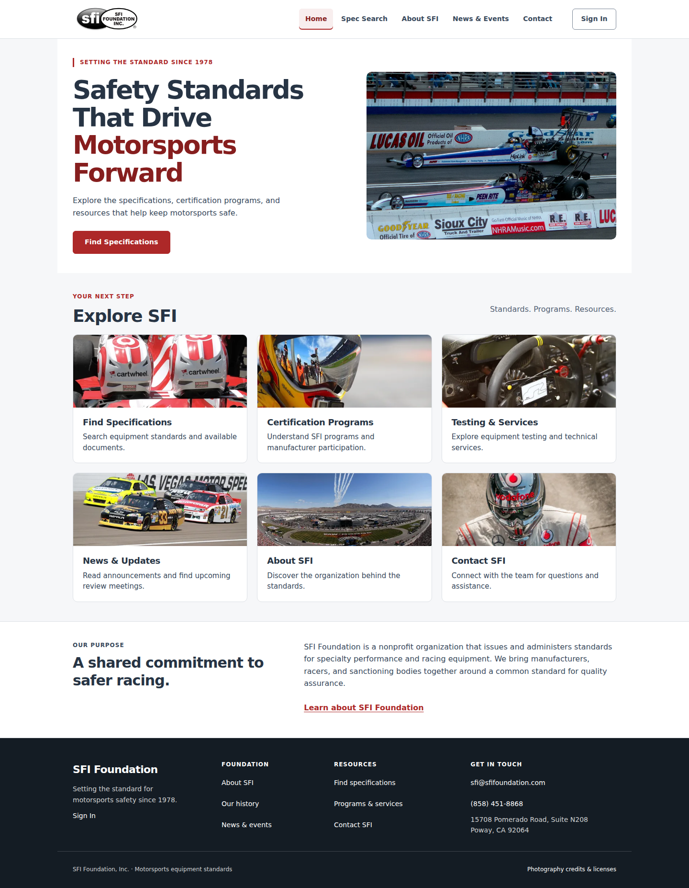 |

## Specification Search (synthetic QA catalog)

| Before | After |
|---|---|
| 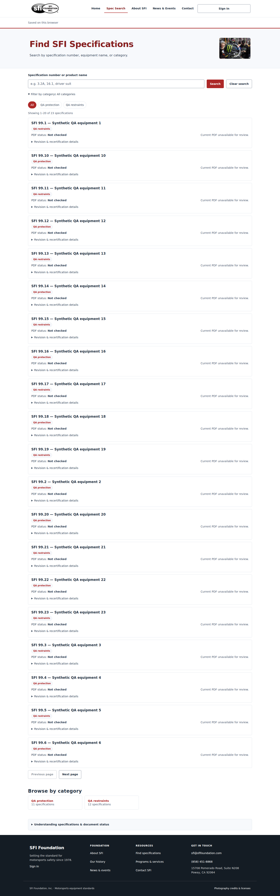 | 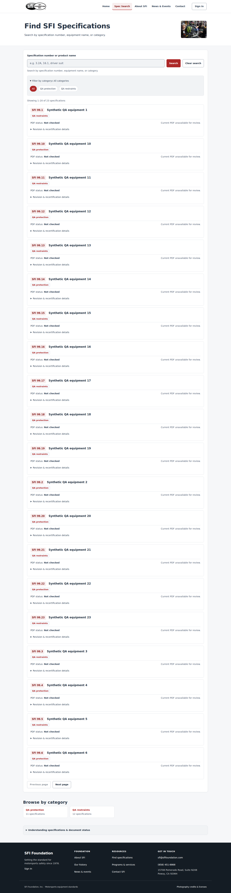 |

## Settings

| Before | After |
|---|---|
| 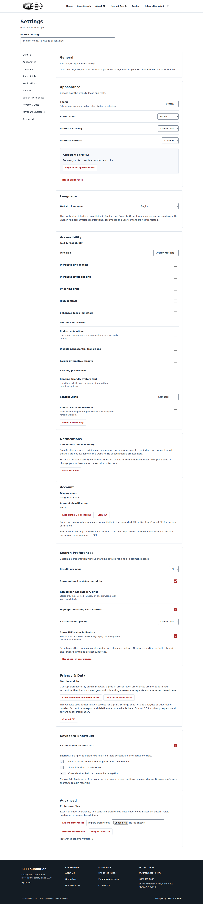 | 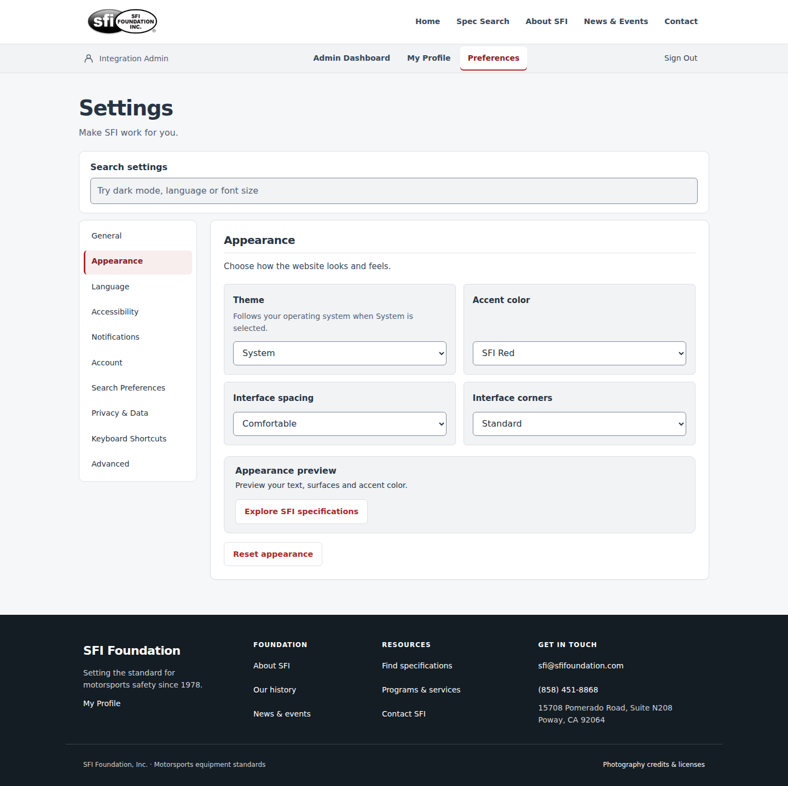 |

## Profile (synthetic account)

| Before | After |
|---|---|
| 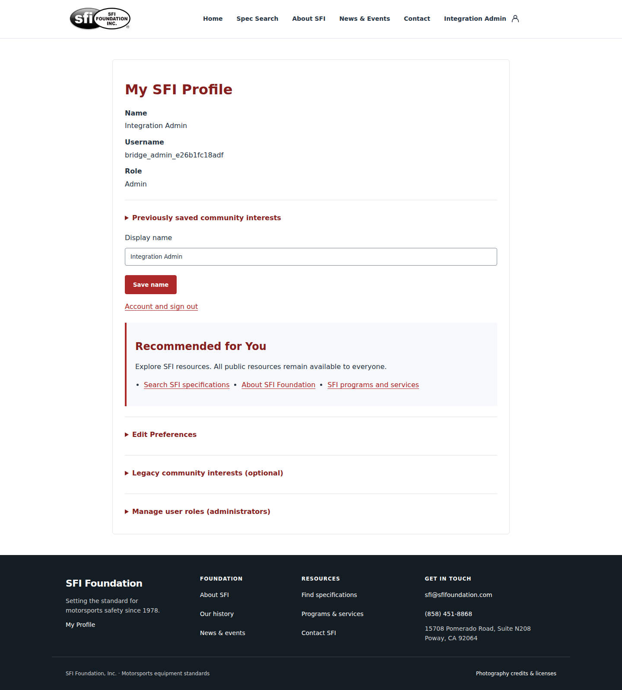 | 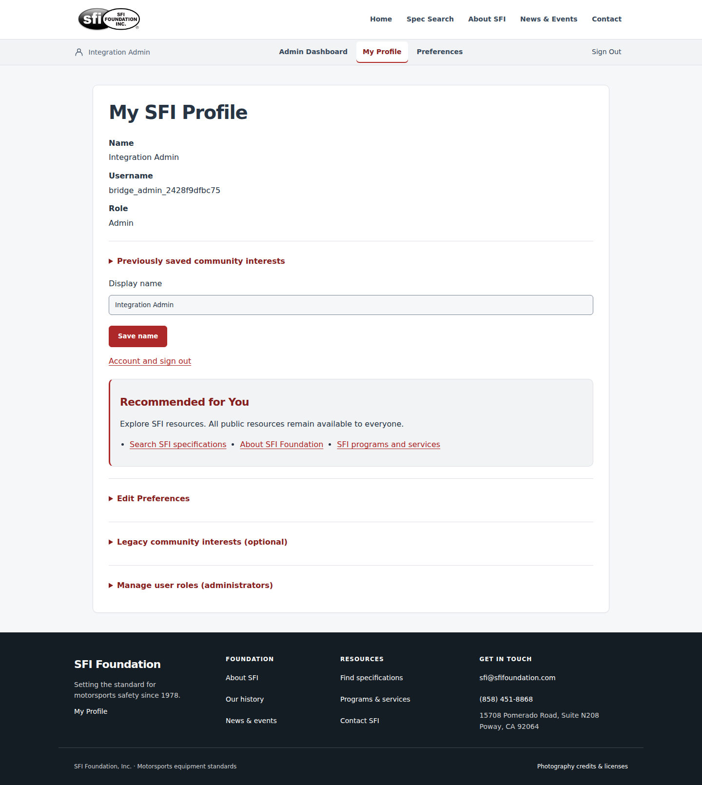 |

## Admin Dashboard (synthetic accounts/counts)

| Before | After |
|---|---|
| 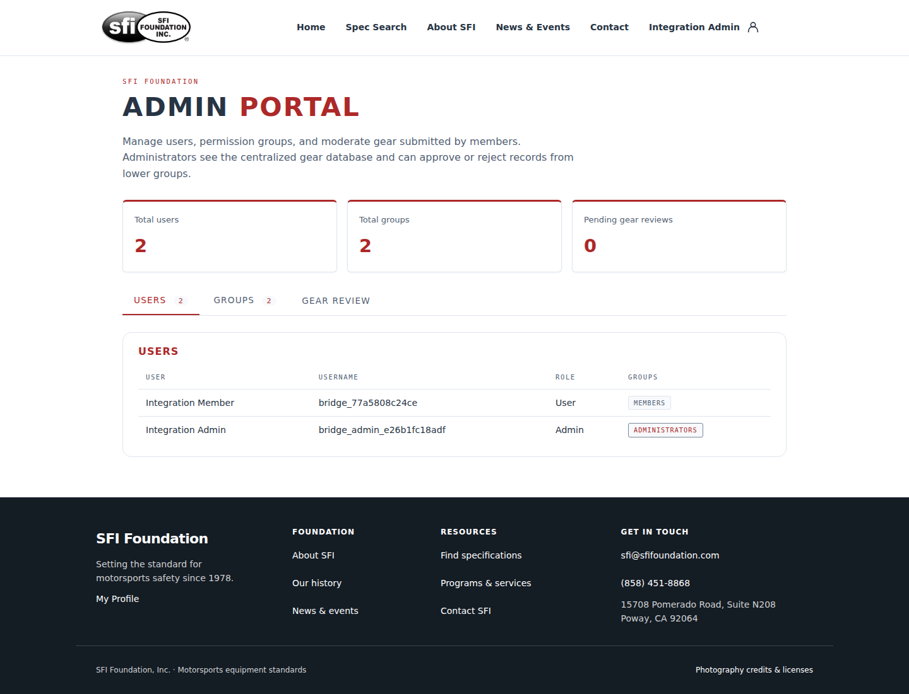 | 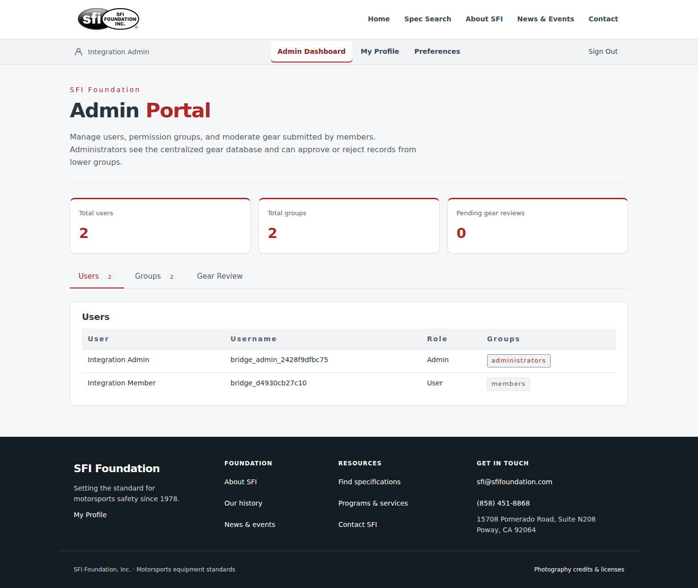 |

## Desktop navigation

| Before | After |
|---|---|
| 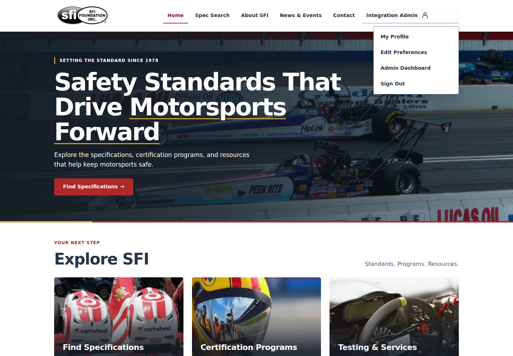 | 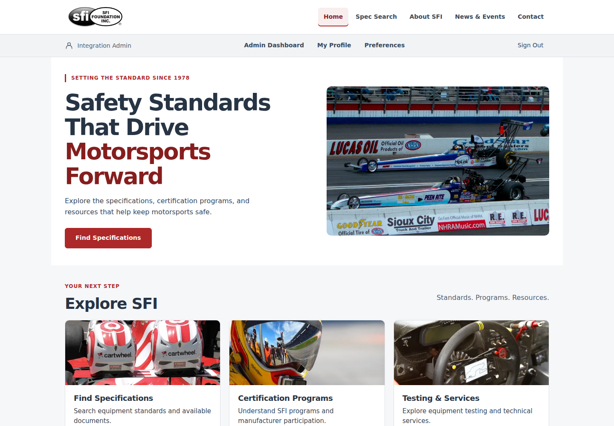 |

## Mobile navigation

| Before | After |
|---|---|
| 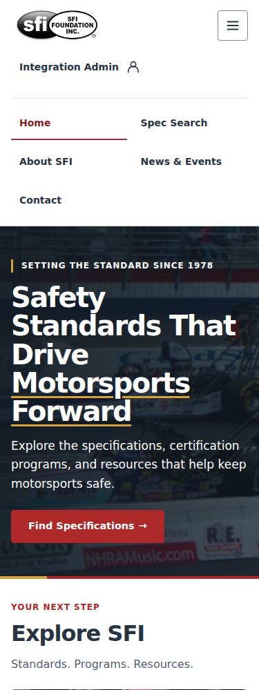 | 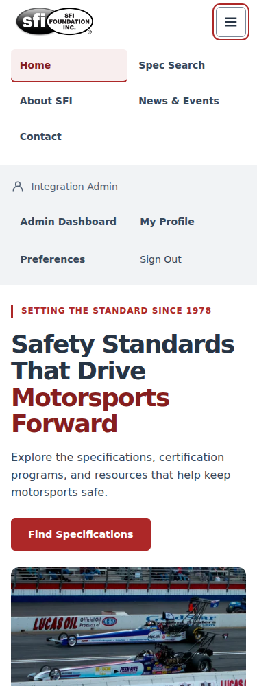 |

## Mobile Settings

| Before | After |
|---|---|
| 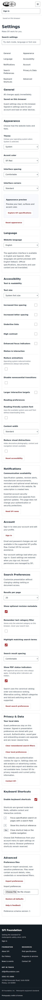 | 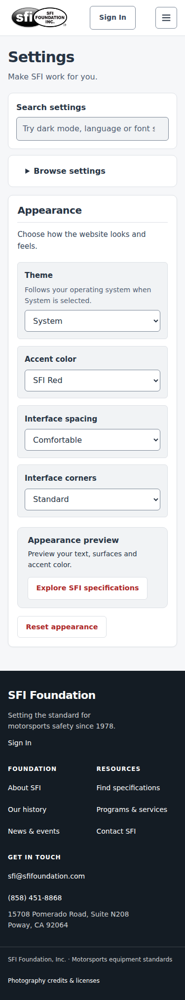 |

## Dark theme and Spanish

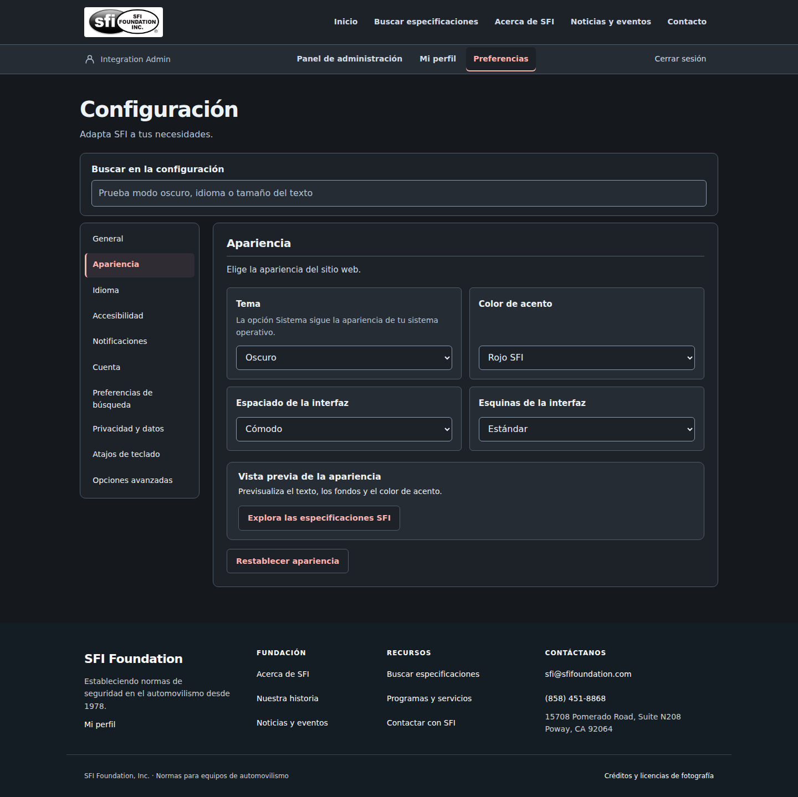

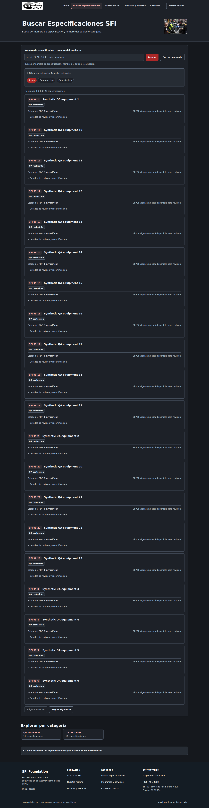

All five requested widths were exercised; complete captures are retained locally under `reports/full-modernization/`. The committed subset keeps this review focused. Automated rendering evidence is in `after-browser-results.json`, `integrated-results.json`, `account-results.json` and `console-results.json`.
