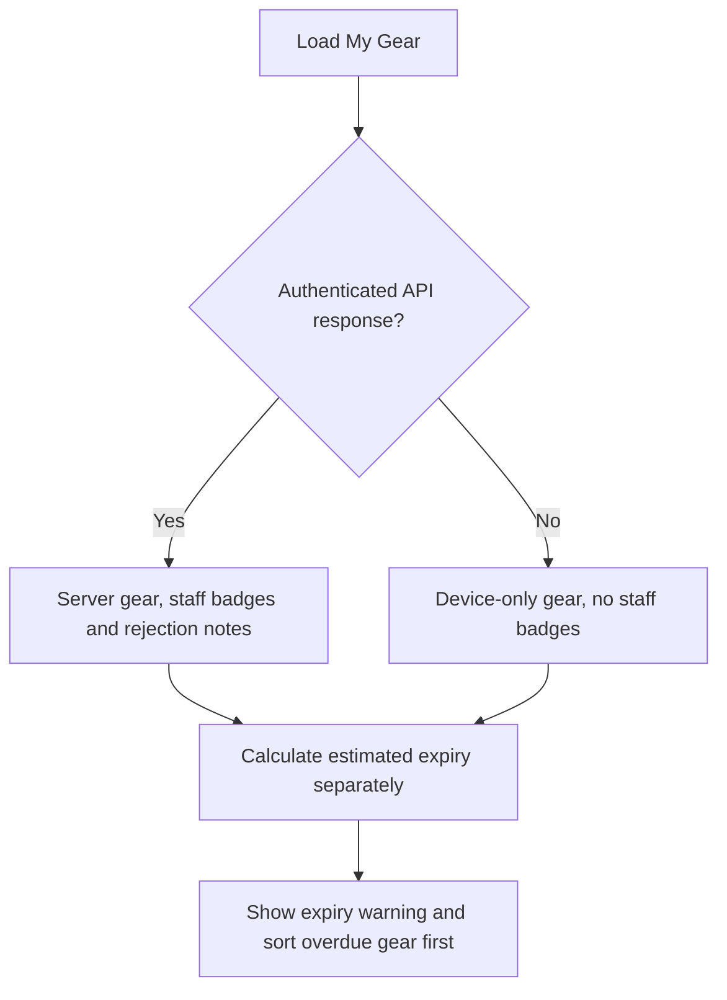
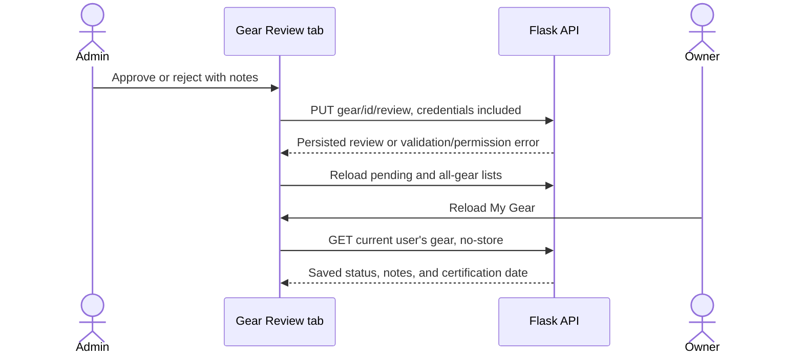

# My Gear review and expiry — Frontend #3

My Gear now shows staff review status and expiry reminders independently. A
pending or rejected item can still show an expiry warning. The existing admin
dashboard has a labeled rejection form and uses the PUT review contract from
[Backend PR #28](https://github.com/SFI-Foundation/Backend/pull/28).

## Design and behavior

The issue identifies two needs: owners need clear review feedback and expiry
information, and staff need usable review controls in the existing dashboard.
How might owners revisit both kinds of information without disrupting guest
storage or the dashboard layout? Keeping separate review and expiry states
preserves both signals; one combined status previously hid overdue reminders.
This design comes from the issue and current code, without claiming stakeholder
interviews or approval. Owner: DrDeyar. Board priority: High.

- Remote gear displays Pending, Approved, or Rejected; missing review data is
  labeled unavailable rather than assumed approved. Canonical `reviewer_notes`
  and existing `reviewNote` data are supported, rendered as text.
- The inherited five-year interval is explicitly a **tracking estimate**. The
  page tells owners to confirm the actual expiry on the equipment label and
  relevant specification; it no longer claims all SFI certifications use that
  period. The score is labeled a reminder score rather than a safety rating.
- Expiry uses calendar days, handles leap-day anniversaries, treats today as
  expiring, and warns at fewer than 90 days remaining. Missing, malformed,
  impossible, and future dates are marked unknown/check-date. Overdue items sort
  first, including those awaiting or failing staff review.
- Signed-out gear keeps the existing `sfiMyGear` localStorage key and add/delete
  behavior, with no staff review badges or stale reviewer notes. Network failures
  show the device-only cache explicitly. Failed remote writes keep the input or
  server record visible and do not copy server gear into local storage.
- Admin review uses the existing Gear Review tab. Reject opens a required text
  field with the item name, supports cancel, and preserves notes on failure.
  Approval/rejection sends `PUT /api/sfi/gear/<id>/review` with `{status, notes}`.
  Controls are disabled while saving, both lists refresh afterward, and failed
  refreshes offer retry. Expired/revoked access hides the private dashboard.
- The dashboard recognizes the trusted Admin role as well as administrators
  group membership, matching the review API. Backend authorization remains the
  authority for every protected action.

## System flow





## Verification — October 28, 2026

- `npm test`: **22 passed** (16 gear scenarios and 6 existing account/profile
  checks), using actual DOM elements and source client code.
- Source client → real Flask → disposable SQLite: **1 integration test passed**.
  It covers member submission, admin PUT approval/rejection, a fresh database
  connection, persisted owner-visible feedback, and logout. Socket binding was
  unavailable, so this used real Flask WSGI over private pipes, not a live HTTP
  deployment. No existing application database was changed.
- Jekyll build passed for the scoped SFI checkout with the configured remote
  Minima theme. Production `/Frontend` script/sign-in paths were verified.
- The focused Sass check passed: actual entry compiled, 30 imports, scoped
  output, and no inline presentation in rendered quiz/admin pages.
- Chromium fixtures: **12 gear scenarios** at 320/375/768/1440px and **12 existing
  dashboard scenarios** at 375/768/1440px passed. These verify rendering, overflow,
  signed-out/offline behavior, rejection form validation, PUT payload, list
  refresh, empty/error/denied states, and tab keyboard navigation. Mobile and
  desktop screenshots were inspected; fixtures are separate from real-API tests.
- Syntax and whitespace checks passed. The broader `test-sfi-sass.rb` audit
  still fails on existing inline styles in unchanged `navigation/sfi-specs.md`.
  Existing Sass import deprecation warnings remain.

Reproduce with project dependencies installed:

```sh
npm ci && npm test && bundle exec jekyll build && npm run test:styles -- _site
```

The browser fixture scripts accept a built-site directory and the existing
`PLAYWRIGHT_MODULE`/`CHROME_PATH` overrides. For the dashboard regression script,
use `SFI_BASEURL=/Frontend` with the production base path. The real-API check is:

```sh
node scripts/test-sfi-gear-integration.mjs /path/to/python /path/to/Backend
```

## Review and deployment

Backend PR #24 is merged. **Backend PR #28 must be merged and deployed before
the new frontend review action works in the shared environment.** On an older
backend, the frontend retains failed-review notes and shows an error; it does
not claim a successful review.

Present a pending overdue item with both badges, a rejected item with its note,
guest add/delete/reload, and admin approval/rejection followed by the owner's
refresh. Deployment, presentation, stakeholder acceptance, and Done are pending
until their evidence is recorded in issue #3.
