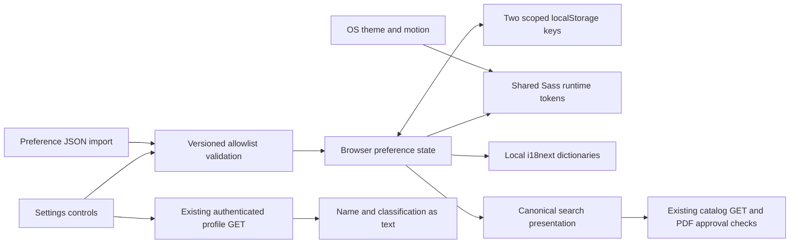

# Settings & Preferences implementation

## Inspection and design (before implementation, 2026-11-17)

The public website uses Jekyll, vanilla JavaScript, scoped Sass under
`_sass/sfi`, a single `sfi.css`, and relative_url routing. The main nav uses
inline SVG and progressive mobile enhancement. Flask supplies HttpOnly cookie
login, ownership-protected profiles and onboarding, and administrator groups.
Public canonical search is `assets/js/sfi/spec-search.js`; its `verifiedUrl`
function allows only approved current PDFs on official SFI HTTPS hosts.
The older classroom `SitePreferences` script uses runtime Google translation;
it is not loaded by the public shell and will stay isolated.

Frontend began clean on the merged onboarding commit. Backend has unrelated
uncommitted feedback files, environment/gitignore edits and deleted artifacts;
none will be staged or changed. Remote main was fetched in each repository.
Frontend feature branch starts at current Foundation main (4b546b0b3), which
includes onboarding. Backend main (a850ce8) includes its onboarding feature;
no backend branch or database migration is planned.

### Proposed implementation

1. Add a versioned, explicit, runtime-validated preference schema with JSDoc
   types, safe localStorage handling, subscriber events and narrow reset/import.
2. Add a persistent navbar gear outside the collapsible mobile links and a
   dedicated responsive `/settings/` page with searchable anchored categories,
   reusable labeled controls, preview and live save/error messages.
3. Use shared CSS custom properties for theme/accent, respect OS appearance
   and motion changes, and provide real readability and interaction controls.
4. Use locally bundled i18next with dictionaries and English fallback. Translate
   settings and navigation in English/Spanish; label additional languages as
   previews with partial coverage. Preserve official terminology, IDs and PDFs.
5. Add search page-size, metadata, density, highlighting and PDF-indicator
   preferences; remember category only with explicit opt-in. Retain canonical
   server ranking/order, pagination and approved-document checks. Defer unsupported
   sorting, category defaults and alternative views instead of reordering one page.
6. Use existing profile and sign-out routes. Show current name/classification
   from authenticated no-store GET; link to the existing name/onboarding editor.
   Defer email/password edits because the supported SFI profile API does not
   provide verified email or a current-password change flow.
7. Explain notification limitations; do not add delivery, subscription switches,
   analytics switches or simulated account deletion/export.
8. Test schema, storage recovery, tokens, OS changes, localization, shortcuts,
   search/PDF invariants and actual responsive browser behavior. Run current
   frontend/backend checks and production Jekyll build using disposable test data.

### Storage and security contract

Preferences are non-sensitive and browser-local for guests and members alike;
they do not synchronize or change at login/logout. On shared browsers the same
preferences apply to every visitor. No preferences are sent to profile APIs.
Only `sfi.preferences.v1` and `sfi.searchFilters.v1` may be reset. Import/export
contains schema version and allowlisted preference keys, never identity, roles,
cookies, tokens, onboarding answers or search text. Invalid imports are atomic:
reject entirely, with no partial application. Storage failure retains in-memory
behavior and is visible on Settings. Existing account permissions stay server-owned.

## Implementation and verification results

The implementation and repeatable verification are detailed below.

### Delivered behavior

The navbar gear is a normal accessible link to `/settings/`, available outside
collapsed mobile navigation. Settings has ten anchored categories, a label-only
search (never account values), immediate updates and live persistence feedback.
All 24 preference fields have real consumers:

- Appearance: light/dark/system, seven contrast-tested accents, comfortable or
  compact settings/cards, standard or rounded corners, and a live sample.
- Language: English/Spanish settings/navigation and primary search controls/states;
  French, German, Simplified Chinese and Japanese are explicitly partial previews.
  i18next is served locally with no translation network calls. Missing keys fall
  back to English. Translated fragments receive their actual language; editorial
  documents retain English. Number formatting uses Intl. The shared date helper
  uses Intl; official revision strings and original PDFs remain unchanged.
- Accessibility: system/small/default/large/extra-large text, increased line and
  letter spacing, link underlines, stronger contrast/focus, reduced animations,
  transition suppression, larger controls, available system sans-serif font,
  reading width and hidden decorative photography. OS reduced motion wins.
- Search: 10/20/50 results, optional revision details, explicit category memory,
  safely marked title matches, result spacing, and optional PDF status indicators.
  Hiding metadata never changes document approvals or enables unavailable links.
- Shortcuts: optional `/` focuses existing specification search, `?` opens native
  modal help, Escape closes help/navigation. Input/composition/interactive-control
  contexts and modifier shortcuts are ignored. Ctrl/Cmd+, remains browser-owned.
- Privacy/Advanced: narrow local clears, category resets, confirmed full reset,
  strict version-1 JSON import/export (16 KiB maximum), real contact/help links.
- Account: existing authenticated no-store profile GET displays name and trusted
  classification; links to existing profile/onboarding editor and cookie logout.
  Visitors see sign-in. Failed account requests provide retry. Theme/language
  stay local through login/logout. Preference files never contain account data.

### Deliberately deferred

There is no preference API or database migration. Browser-local persistence
avoids coupling display settings to onboarding or introducing an unreviewed
schema. There is no cross-device sync, per-account storage or guest merge.
On shared devices, preferences affect anyone using the same browser/origin.

Notifications have explanatory content and a real news link, with no inactive
subscription controls or outbound delivery. The supported SFI profile API edits
display names through the existing profile page; it does not provide a verified
email or current-password change workflow. This release does not add either,
account deletion/export, role editing, optional analytics, a fabricated privacy
policy, unsupported search sort/view modes, or a fake app version. Contact links
provide a real path for account/privacy assistance. Simplified interface is
limited to reading width and decorative-photo suppression; content is retained.

English/Spanish key coverage is checked automatically and wording was reviewed
in source, but professional linguistic review and full site-wide editorial,
account-form, and technical-data translation remain release limitations. Preview
languages intentionally fall back to English. No runtime machine translation is
used. Full manual screen-reader and assistive-technology review remains necessary;
automated semantic/focus checks alone cannot establish WCAG 2.2 conformance.

### Architecture and maintenance

`preferences.js` is a small synchronous head script to apply validated appearance
before CSS loads. JSDoc describes the preference record; enum/type allowlists are
runtime authority. Default/partial version-1 payloads merge with current defaults;
unknown versions, extra envelope keys, unsafe types and unknown preference keys
are rejected. Malformed storage recovers to defaults. Blocked storage uses an
in-memory session with a visible warning. Valid storage events update other tabs.
Imports validate completely before applying anything. Resets touch only the two
SFI preference keys, never cookies, gear, legacy storage or onboarding.

Sass remains one compiled, SFI-scoped stylesheet. Existing public declarations
consume shared runtime surface/text/link/accent tokens instead of fixed Sass
colors. White on photographic or dark brand surfaces stays white. Primary accent
fills and link ink are separate for dark-theme contrast. Logo image bytes and
official branding are unchanged. HTML data attributes select state; no user CSS
is interpolated. The small static accent palette is the only source of inline
custom-property values.

The MIT i18next browser bundle and license are vendored intentionally, because
Jekyll does not bundle npm modules. `package-lock.json` pins the dependency;
`npm run vendor:i18n` reproduces the two assets after an approved dependency
update. The localization implementation follows the
[i18next API](https://www.i18next.com/overview/api) and its
[fallback behavior](https://www.i18next.com/principles/fallback).

### Local run and repeatable checks

From `SFI-Frontend`, use the existing dependencies and preview:

```sh
npm ci
bundle install
make jekyll-serve
# Open http://localhost:4500/settings/ (or click the header gear).
npm test
npm run test:settings
JEKYLL_ENV=production bundle exec jekyll build --destination /tmp/sfi-settings-site --disable-disk-cache
npm run test:styles -- /tmp/sfi-settings-site
npm run test:redesign -- /tmp/sfi-settings-site
SFI_BUILT_SITE=/tmp/sfi-settings-site npm run test:public-build
python3 scripts/test-sfi-paths.py /tmp/sfi-settings-site
```

For a running account API, follow the backend README; do not run a destructive
initializer on an existing database. Settings itself works without the backend;
only the account card requires it. The local API resolver still targets port
8605; production resolution and credentialed CORS are unchanged.

The browser regression uses the existing profile bridge: disposable SQLite and
real Flask HTTP over a private Unix socket, with browser cookies/CORS forwarded.
It aborts external requests and never opens the real app database:

```sh
PLAYWRIGHT_MODULE=/path/to/playwright \
node scripts/test-sfi-settings-browser.mjs \
  ../SFI-Backend/venv/bin/python ../SFI-Backend \
  /tmp/sfi-settings-site /tmp/sfi-settings-browser
```

Set `CHROME_PATH`/`LD_LIBRARY_PATH` only if required by local Chromium tooling.
Backend verification is `venv/bin/python testing/test_sfi_profile.py` (self-isolating)
and `PYTHON_DOTENV_DISABLED=1 SFI_DATABASE_URI=sqlite:////tmp/sfi-settings-unit-tests.db
venv/bin/python -m unittest discover -s tests -v`. MySQL checks need a separately
configured, explicitly disposable `SFI_QA_MYSQL_URI`; never use a production URI.


### Verification record (2026-11-17)

| Area | Result and evidence |
| --- | --- |
| Frontend profile/onboarding/gear/settings | 45 tests passed using `--test-isolation=none`; default `npm test` also passed. |
| Settings + canonical search | 30 tests passed, including all preset contrast math, live OS themes/motion, storage recovery, strict imports, translated controls, account display and protected PDF link invariants. |
| Phase 1 public search/manufacturer boundary | 20 tests: 18 passed, two built-site-only cases skipped in the source-only invocation; those checks also ran against production output. |
| Backend full unittest discovery | 84 tests: passed with three MySQL-only skips. Disposable SQLite only, `.env` disabled. Includes auth/recovery, catalog approvals, migrations, public security and gear. |
| Backend isolated profile/onboarding | 19 tests passed, including administrator authentication and role/ownership restrictions. |
| Backend syntax compilation | `compileall` passed for API/model/scripts using a temporary pycache root. Flask has no separate production compilation step. |
| Current shared stylesheet | `test:styles` passed with 30 imported partials; SFI scope includes allowlisted HTML preference attributes. |
| Existing photographic/public design | `test:redesign` passed: thirteen licensed photographs, six linked cards, real destinations and compiled Sass. |
| Public build safety/search index | Seven checks passed, scanning 2,736 output files for known secrets and fictional manufacturers and checking the real Jekyll search template/index. |
| Internal paths | Fifteen standard routes, 460 navigation/asset targets passed; Settings is additionally exercised through the real browser navbar. |
| API configuration | Local, loopback, Pages/custom-domain defaults and auth/quiz URL/credential contract passed. |
| Existing onboarding browser | Passed at 1440, 1024, 768, 390 and 320 pixels: real cookie signup/login, save/reload/edit, role isolation, administrator access and keyboard/contrast. |

The Settings Chromium suite passed at **1440, 1024, 768, 390 and 320 pixels**.
It verified actual controls, live OS themes/motion, all seven accents in both
light/dark themes (70 settings/navigation text-contrast combinations), enlarged
text/spacing/targets with no overflow, persistence after reload, English/Spanish
switching and Japanese fallback, real file import/export, native modal keyboard
help and focus return, guest/member/admin account displays, dark login errors,
session-preserving resets, canonical search and withheld unapproved PDFs. No
browser JavaScript errors were recorded. Desktop and phone screenshots were
inspected. Raw browser logs and the full capture set are in `/tmp/sfi-settings-*`. Selected
non-sensitive review images are committed below; no generated website is committed.

Issues found during verification were fixed: narrow category labels at 320px
with enlarged text, dynamic status messages surviving localization, account data
excluded from Settings search, and dark-mode semantic status surfaces. Browser
checks wait for actual CSS/media transitions rather than sampling intermediate
colors. The search fixture now prepares the existing additive catalog migration
inside its isolated copy, because the original profile bridge did not include it.

The historical standalone `test-sfi-sass.rb` still fails on the deliberately
disconnected chatbot partial, a pre-existing README-documented condition. It was
not changed to load that widget or to hide the failure. The supported public Sass
and redesign checks pass. Jekyll emits existing post-link/duplicate-output and
Sass deprecation warnings; they are outside this feature. The first restricted
build could not resolve the remote theme; approved network-enabled production
builds succeeded. Browser startup uses the installed Chromium path explicitly
because the temporary Playwright package expects another browser revision.

`npm audit` reports two existing high-severity development-tool advisories
(picomatch through @parcel/watcher); no production/i18next vulnerability was
reported. The lockfile change adds i18next only. No unrelated dependency upgrade
was made. Complete manual screen-reader testing, a real MySQL QA schema,
production deployment/cross-device behavior, camera hardware and outbound
notifications are outside this validation.

Foundation main advanced during implementation to `fd301b6ed` with separate
homepage/deployment changes and an unused legacy styles include. Those changes
do not overlap Settings files. The feature retains its inspected starting
baseline `4b546b0b3`; the draft PR targets `main` and neither overwrites nor
reverts those incoming changes.


### Files and security review

Created modules: `assets/js/sfi/preferences.js` (typed validated store),
`localization.js`/`locales.js` (local dictionaries/locale helpers), `settings.js`
(reusable controls and read-only account view), and `shortcuts.js` (guarded keys
and native dialog). `navigation/settings.html` and `pages/_settings.scss` define
the new interface. The layout/nav load the runtime and add the always-visible
gear. Existing public Sass partials now consume shared theme variables; no
per-theme stylesheet or branding asset was added. `spec-search.js` and its page
add preference consumers while leaving `verifiedUrl` unchanged. Package files,
the MIT browser bundle/license and vendor script define the only new dependency.
Tests cover the store/UI, existing search and isolated real-browser flows.

New runtime account networking is GET-only, cookie-authenticated and no-store.
No new backend route, authorization bypass, HTML-from-preferences rendering,
role editor, production database change, outbound email, token export, analytics,
secret file or generated site artifact is included. The complete frontend diff
was reviewed. Backend Git status remains exactly as observed at inspection,
including the unrelated feedback work. Auto-merge is not enabled.

Full frontend file inventory for this feature:

- `README.md`
- `_includes/sfi/nav.html`
- `_layouts/sfi.html`
- `_sass/sfi/_main.scss`
- `_sass/sfi/_mixins.scss`
- `_sass/sfi/base/_accessibility.scss`
- `_sass/sfi/base/_foundation.scss`
- `_sass/sfi/base/_layout.scss`
- `_sass/sfi/base/_page.scss`
- `_sass/sfi/components/_buttons.scss`
- `_sass/sfi/components/_data.scss`
- `_sass/sfi/components/_feature-grid.scss`
- `_sass/sfi/components/_footer.scss`
- `_sass/sfi/components/_image-banner.scss`
- `_sass/sfi/components/_navigation.scss`
- `_sass/sfi/elements/_button.scss`
- `_sass/sfi/elements/_card.scss`
- `_sass/sfi/elements/_form.scss`
- `_sass/sfi/elements/_table.scss`
- `_sass/sfi/pages/_admin.scss`
- `_sass/sfi/pages/_auth.scss`
- `_sass/sfi/pages/_contact.scss`
- `_sass/sfi/pages/_content.scss`
- `_sass/sfi/pages/_detect.scss`
- `_sass/sfi/pages/_document.scss`
- `_sass/sfi/pages/_gear.scss`
- `_sass/sfi/pages/_home.scss`
- `_sass/sfi/pages/_photography.scss`
- `_sass/sfi/pages/_profile.scss`
- `_sass/sfi/pages/_settings.scss`
- `_sass/sfi/pages/_specs.scss`
- `assets/js/sfi/locales.js`
- `assets/js/sfi/localization.js`
- `assets/js/sfi/navigation.js`
- `assets/js/sfi/preferences.js`
- `assets/js/sfi/settings.js`
- `assets/js/sfi/shortcuts.js`
- `assets/js/sfi/spec-search.js`
- `assets/js/vendor/i18next.LICENSE`
- `assets/js/vendor/i18next.min.js`
- `docs/settings-preferences.md`
- `navigation/settings.html`
- `navigation/sfi-specs.md`
- `package-lock.json`
- `package.json`
- `scripts/sfi-settings-fixture.py`
- `scripts/test-sfi-gear-sass.mjs`
- `scripts/test-sfi-redesign.mjs`
- `scripts/test-sfi-settings-browser.mjs`
- `scripts/test-sfi-theme-contrast-browser.mjs`
- `scripts/test-sfi-settings.mjs`
- `scripts/test-sfi-spec-search.mjs`
- `scripts/vendor-sfi-i18next.mjs`


Additional documentation assets:

- `docs/settings-screenshots/light-desktop.png`
- `docs/settings-screenshots/dark-desktop.png`
- `docs/settings-screenshots/light-mobile.png`
- `docs/settings-screenshots/dark-mobile.png`

### Review screenshots and data flow

These are new-page screenshots at 1440px and 320px, captured with synthetic guest
preferences; they contain no account data. There is no prior Settings screen.

| Appearance | Desktop | Phone |
| --- | --- | --- |
| Light | [1440px](settings-screenshots/light-desktop.png) | [320px](settings-screenshots/light-mobile.png) |
| Dark | [1440px](settings-screenshots/dark-desktop.png) | [320px](settings-screenshots/dark-mobile.png) |



Only account display and the existing catalog use the backend. Preference
validation/storage never enters identity or authorization data flows. Screenshot
files above are documentation evidence, not generated website output.


Final production build completed successfully in 689.534 seconds with the
configured remote theme and incremental mode disabled. Final runtime JavaScript
assets match source byte-for-byte and the new search localization annotations
are present in generated HTML. Sass byte comparison accounts only for quote
serialization of the known `--sfi-font: Inter, Arial, sans-serif` declaration:
Jekyll's embedded Sass emits single quotes and npm Sass emits double quotes.
All other CSS remains compared exactly. `scripts/test-sfi-redesign.mjs` records
that narrow compiler-compatibility normalization; it does not ignore style changes.

## PR #35 finalization review — 2026-11-17

The complete PR diff was reviewed against the latest fetched `origin/main` and
Foundation `main` (`fd301b6ed` at review). A merge-tree simulation found no
conflicts. The review preserves the original implementation and adds only the
contrast fixes and browser regression below; no backend changes are required.

### Defects found and fixed

A real Chromium/axe check of markup emitted by the existing gear renderer found
rejected-card metadata at 3.86:1 contrast. Its inherited opacity reduced text and
badge contrast in light mode; pending/rejected cards also retained light-tinted
backgrounds with light text in dark mode. The detector CTA paired its white
button background with a pale dark-theme link color. These were accessibility
regressions to fix before changing PR status, not limitations to waive.

- Rejected equipment cards no longer reduce the opacity of their text/badges.
- Pending and rejected cards use the shared dark surface in dark mode.
- The detector CTA button uses the shared surface token for both fill and border.
- `scripts/test-sfi-theme-contrast-browser.mjs` renders actual gear UI markup and
  the actual detector CTA with generated CSS. It checks both themes, all seven
  accents, high contrast on/off, and desktop/phone widths: 56 axe contrast scans.
  The original CSS fails this test; the corrected candidate passes all 56 scans.

The new test uses external browser QA tooling, matching the existing browser
scripts; it does not add a production dependency or change preference values,
review statuses, authentication, catalog ranking or PDF authorization.

```sh
PLAYWRIGHT_MODULE=/path/to/playwright \
SFI_AXE_CORE=/path/to/axe-core/axe.min.js \
node scripts/test-sfi-theme-contrast-browser.mjs /path/to/built-site
```

### Limitation assessment and merge decision

The historical `test-sfi-sass.rb` failure remains nonblocking for this scoped PR:
it flags the deliberately disconnected chatbot partial, which is unchanged and
not imported or loaded by the public SFI shell. The current public stylesheet
compilation/scope and generated-output checks remain the applicable runtime
checks. The historical audit was not weakened to hide its failure.

Manual assistive-technology review remains outstanding. Automated label,
keyboard/focus, responsive and contrast checks are useful evidence but do not
establish full WCAG 2.2 conformance. Ten additional axe WCAG A/AA scans of Settings
and keyboard-help dialog states passed across English/Spanish, light/dark, and
desktop/phone views. A full manual screen-reader review is a release follow-up;
there is no known unresolved accessibility defect to keep this PR in Draft once
the fixes pass final production-output verification.

Professional translation review also remains a release follow-up. English and
Spanish key coverage and switching/fallback tests pass. Four other languages
remain explicitly partial previews; editorial/account/official technical text is
not represented as fully translated. This limitation does not prevent review of
the clearly scoped core UI and fallback behavior.

The dependency audit reports zero production vulnerabilities. Two pre-existing
high-severity development-only advisories (picomatch/@parcel/watcher) remain
outside this feature. Vendor bundle/license bytes match the locked dependency;
no credential signatures, database files, generated website output, unrelated
source files, specification data or brand-image changes were found in the PR.
Backend tracked/untracked work was checked against initial content fingerprints
and is unchanged. Its 84 tests (three MySQL-only skips) and 19 isolated profile
tests passed. Frontend source regressions ran 70 checks: 68 passed, with two
build-output cases reserved for the completed production build.

Marking Ready for Review is appropriate after final checks. This is not an
approval to merge: a teammate review is still outstanding, as required by the
repository PR checklist. No merge, deployment or auto-merge is authorized by
this review. Final generated-output and browser results are recorded below.

The latest main branch also removes a duplicate homepage About button. The
existing photographic-design test still required that removed hero button.
Its assertion now checks the primary navigation's real About link instead,
retaining destination coverage without restoring the obsolete button or changing
homepage content in this PR. The known main homepage change is additionally
checked against a temporary generated-site fixture with that button removed.

### Final generated-output verification

The fresh full production Jekyll build passed in **893.259 seconds**, using the
configured remote theme with incremental mode disabled. Its generated CSS matches
the reviewed final Sass, and preference/search JavaScript matches source exactly.
All checks below passed on that output:

- Shared Sass scope/compilation, full photographic-design checks, internal paths,
  API configuration, and the latest-main homepage compatibility fixture.
- Seven public-build safety/search-index checks; the two source-invocation skips
  are covered by these generated-output checks.
- All 56 axe gear/CTA contrast scans, and ten Settings/help WCAG A/AA scans with
  zero violations and no incomplete rules reported.
- Real Chromium → isolated Flask → disposable SQLite Settings flows at 1440,
  1024, 768, 390 and 320 pixels: guest/member/admin, theme/accessibility/language
  persistence, safe imports/exports, keyboard/help focus, session-preserving
  reset, canonical search and unavailable-PDF protection; no JavaScript errors.
- Existing onboarding browser suite at the same five widths: registration,
  save/reload/edit, role restrictions and preserved administrator login/access.

No PR-triggered GitHub checks were configured/run for the reviewed head; the
checked-in deployment workflow targets main. Local verification is explicit here
rather than being represented as a green GitHub CI run. Logs and detailed JSON
results for this finalization are under `/tmp/sfi35-review/` and are not committed.
The existing PR is to be marked Ready for Review; approval remains outstanding,
and no merge, deployment or auto-merge was performed.
