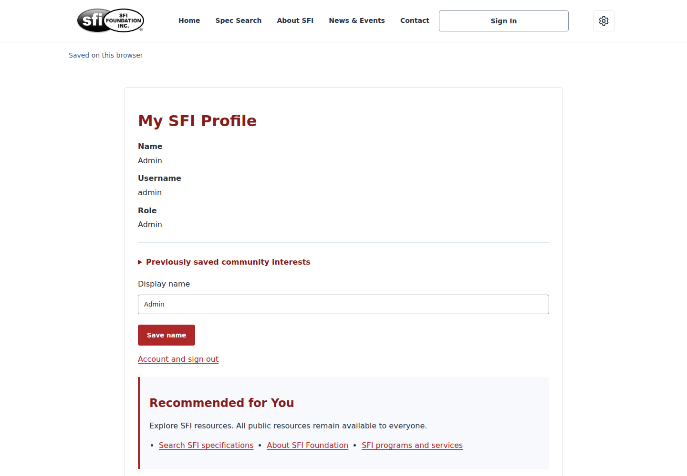
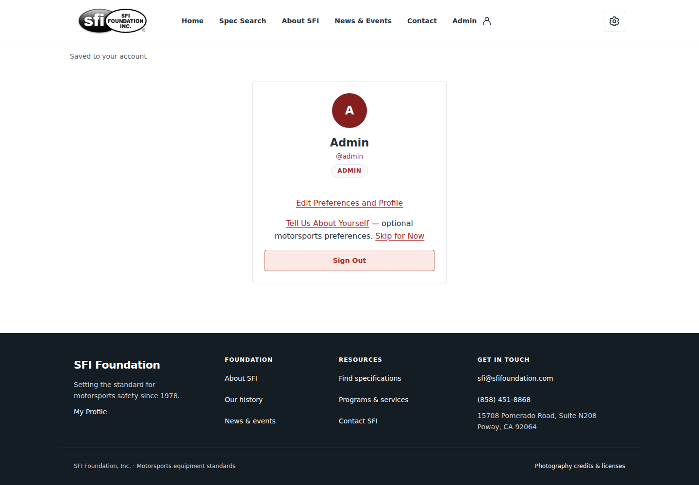
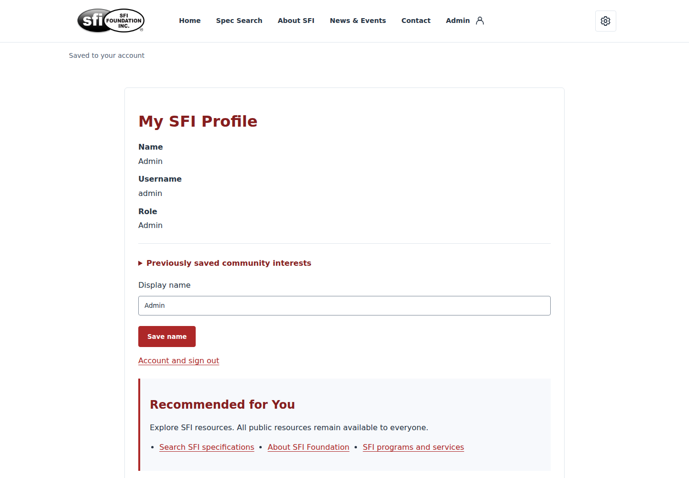
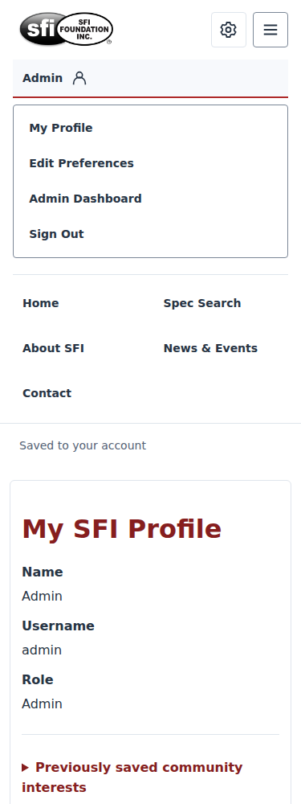
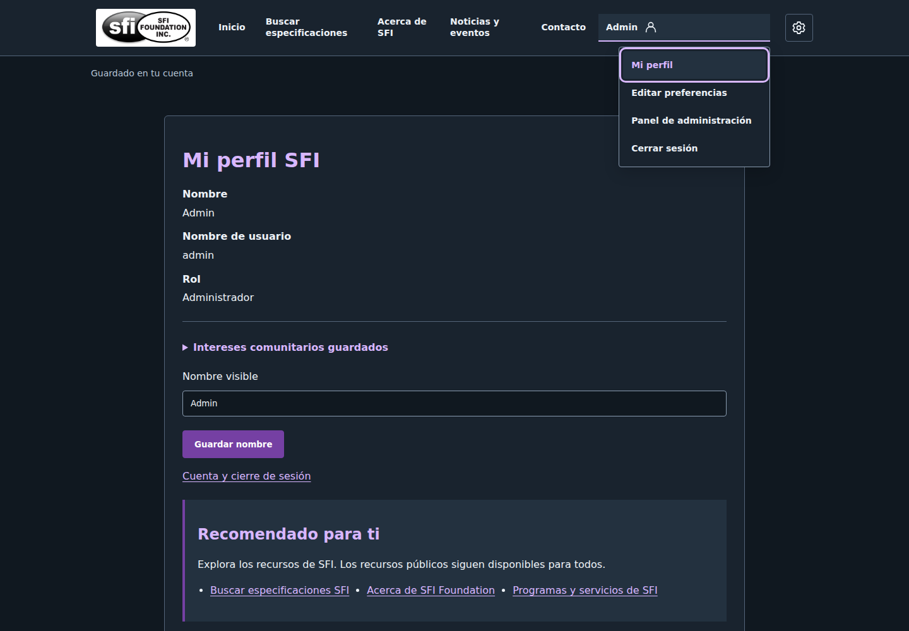
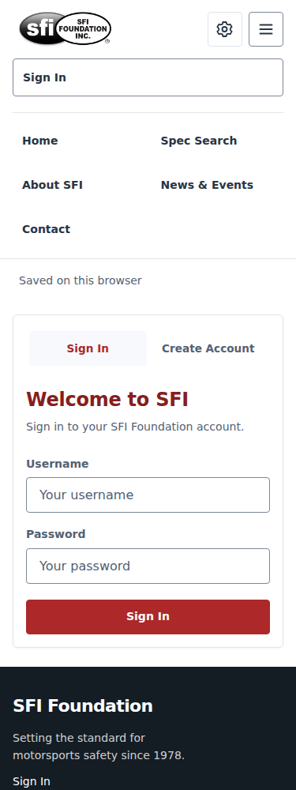

# PR #41: Admin profile and header consistency

## Reproduction and root cause

The previous PR build could show **Admin in the profile and Sign In in the header after session expiry**. The header followed `SFIAuth`, while the profile independently fetched its data once and retained that rendered identity. A later authenticated-session check returned 401 and cleared the header, but the profile did not subscribe to that change. The new real-browser regression failed against the previous build because `#profileContent` remained visible after the browser's HTTP-only cookie expired.

The legacy `sfi-auth` event also accepted a null payload as proof of logout. An old sign-in form's presentation event could therefore clear a newer verified session. Presentation changes now trigger cookie revalidation rather than declaring logout.

There is a separate publication issue on the public site. On November 18, the public `/sfi-profile/` HTML still contained the original static Sign In anchor and no account-control markup; `/assets/js/sfi/auth.js` returned HTTP 404. That public build does not contain draft PR #41. No authenticated production session or production credentials were accessed. The source fix and the screenshots here are from the PR branch; the public website will continue serving its existing build until a separately authorized merge and deployment.

## Changes

The existing cookie session and `/api/sfi/profile` remain authoritative. The profile now reuses the shared session request instead of making an independent initial read, and subscribes to the same verified session updates as the header. A confirmed expiry clears both views; reauthentication restores both. Server-backed identity and permission changes update the profile without overwriting another form's unsaved edits.

The account card on `/login/` also follows the shared session. Showing its signed-out form no longer broadcasts an unconditional logout. Stale legacy notifications revalidate the existing cookie, and temporary failures preserve a previously verified account. Admin-menu access continues to depend on the backend's `can_manage_roles` flag, not a username or onboarding answer.

The dropdown contains **My Profile**, **Edit Preferences**, the authorized **Admin Dashboard**, and **Sign Out**. Edit Preferences opens the existing `/settings/` page and uses the existing English/Spanish translation.

| Source file changed in this follow-up | Purpose |
| --- | --- |
| `assets/js/sfi/profile.js` | Shared session lookup and profile/header lifecycle, expiry clearing and reauthentication |
| `assets/js/sfi/auth.js` | Revalidate legacy signed-out events instead of erasing verified authentication |
| `navigation/login.md` | Account card follows canonical session state; form rendering does not declare logout |
| `_includes/sfi/nav.html` | Requested Edit Preferences label and existing settings destination |
| `scripts/sfi-settings-fixture.py` | Optional literal Admin/@admin and member fixtures, restricted to the already guarded disposable source/database copy |
| `scripts/test-sfi-account-browser.mjs` | Simultaneous profile/header assertions, public-page refreshes, Admin expiry/sign-out and screenshots |
| `scripts/test-sfi-account-menu.mjs` | Shared-read, expiry, reauthentication and stale-event regressions |
| `docs/sfi-account-navigation.md` | Updated verification totals, menu and fixture documentation |
| `docs/sfi-account-navigation-follow-up.md` | This report |
| `docs/account-navigation/` | Updated screenshots and machine-readable test evidence |

No backend source, authentication policy, production account, environment file or database was changed. Existing unrelated backend feedback work is untouched.

## Verification results

- The exact expired-session regression **fails on the previous PR build** and passes with the fix. Both runs use Chromium, the real isolated Flask app, the real User model and a disposable SQLite database.
- **79 frontend tests pass**, including the two added session/profile consistency regressions. `npm test` passes.
- **Five-width browser matrix passes:** 320, 375, 768, 1024 and 1440px, with both Admin and member accounts. Each account visits and refreshes Home, Spec Search, About, News, Contact, Settings and Profile while the header retains the verified name. The profile and header are asserted together.
- The fixture provisions **Admin/@admin with a generated password** in the isolated database. The normal UI and existing cookie-authentication API perform sign-in; screenshots contain no real account credentials. The `/login/` account card and `/sfi-profile/` page both show Admin while the header shows Admin.
- A separate **1440px/375px focused run passes the complete Admin sign-in → profile → dropdown Sign Out path**, with Sign In restored and the Admin account card hidden. It also repeats the member, expiry, navigation and refresh checks.
- **280 axe WCAG A/AA header audits pass with zero violations**, covering both account types, English/Spanish, light/dark and all seven accents. Keyboard arrows, Home/End, Tab, Escape, outside clicks, focus restoration and responsive overflow checks pass.
- The existing registration/onboarding Chromium suite passes at its five widths. Production Jekyll, generated API configuration, scoped Sass, photographic redesign and **7 public-artifact/search/photo checks pass**.

The runtime fix is frontend-only. Backend authorization is exercised through actual member 403 and administrator 200 responses. Temporary 503/network failures retain identity; cross-tab identity changes, cookie expiry and reauthentication are covered. The unchanged backend's earlier SQLite/MySQL test results remain documented in the parent report.

[Full five-width results and 280 audits](account-navigation/results.json) · [Focused desktop/mobile Admin sign-out results](account-navigation/responsive-sign-out-results.json)

## Proof screenshots

Admin and @admin in the account card, with Admin in the same page's header:

Admin in the editable profile and header:

Mobile profile and account menu, showing both Admin identity and the requested links:

Spanish and dark theme preserve the account identity and administrator permission:

Admin sign-out restores Sign In:

## Scope and limits

PR #41 remains a draft targeting `main`; nothing is merged or deployed. The public site currently serves older assets. Browser tests use local Chromium and disposable development cookies, not a production login. Background expiry checks can take up to one minute while a tab remains visible. Cross-tab account changes reload existing private pages and may discard unsaved edits. Accessibility coverage is scoped to the changed header/menu, and the existing unrelated legacy build warnings remain.
