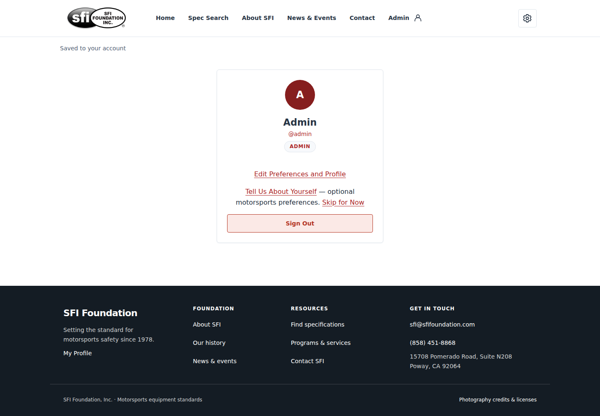
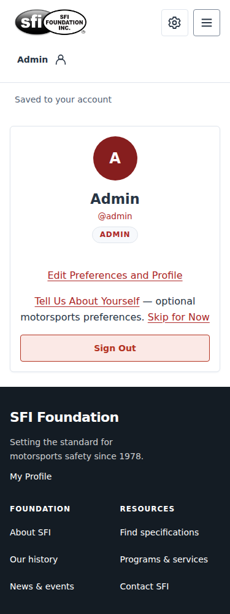
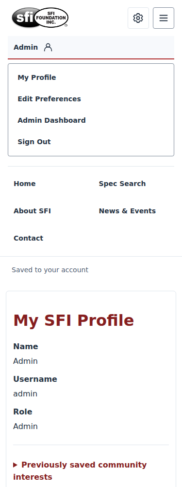
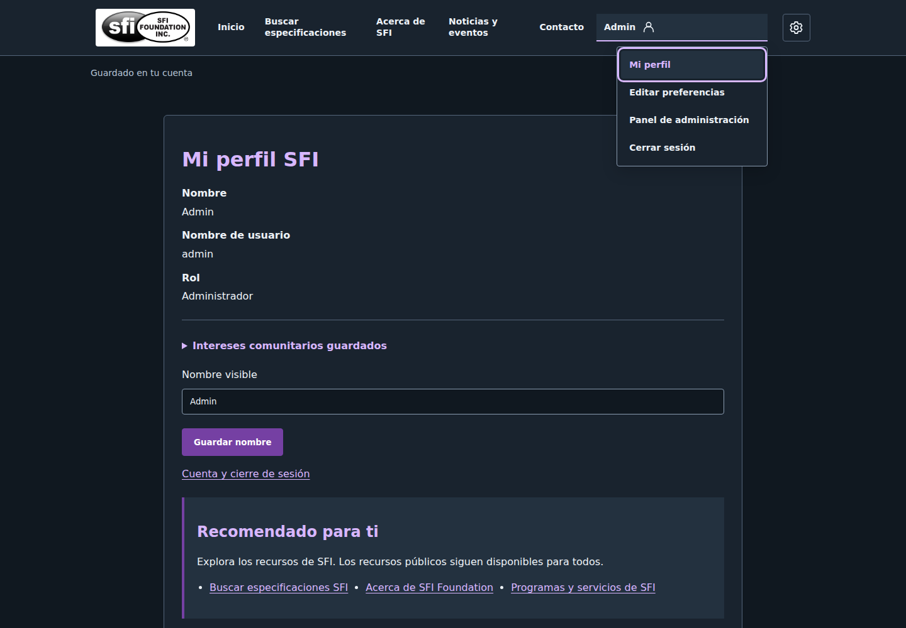

# OCS-style SFI account navigation and deployment

## Current behavior

The authenticated account name is a text navigation control next to the existing public links. Sign In is hidden when the existing cookie session verifies successfully. Clicking the name opens My Profile, Edit Preferences, backend-authorized Admin Dashboard, and Sign Out. The control keeps native menu-button semantics for keyboard and assistive-technology support, while matching navigation-link typography and appearance.

On mobile, the account control stays visible beneath the existing brand/settings/menu row even when the public links are collapsed. Opening or closing the public links does not hide the authenticated name. Public link order, branding, theme/accent preferences, translation and the shared session mechanism remain intact. No second authentication system or client-stored identity is introduced.

## Why earlier changes were not visible

Read-only GitHub and HTTP checks on November 18 Pacific time established the following:

| Finding | Evidence |
| --- | --- |
| PR #41 is open, draft and unmerged | Head branch `fix/sfi-authenticated-account-navigation`; base `main` |
| Pages deploys from main through Actions | Pages settings specify main; `.github/workflows/jekyll-gh-pages.yml` runs on main pushes or explicit manual invocation |
| Production is older than current main | Last successful deployment `7840903623` uses `4b546b0b3d9cd155a33264351ffea7fbf57ed2e2`, fourteen commits behind main `b6151edbb4900871b339eb9aea0d4fee74c81805` |
| The latest main build failed before Jekyll | [Run 44393771957](https://github.com/SFI-Foundation/Frontend/actions/runs/44393771957), notebook conversion step: `ModuleNotFoundError: No module named 'progress_bar'`; Jekyll and deployment were skipped |
| Public HTML still has a static Sign In link | Public `/sfi-profile/` contains no `accountToggle` or shared-auth script reference |
| The new auth asset has not been published | Public `/assets/js/sfi/auth.js` returns 404 |
| Browser cache clearing cannot publish the missing change | A unique query string and `Cache-Control: no-cache` still return the old HTML and 404; the profile response is a fresh cache miss |

The [last successful Pages deployment](https://github.com/SFI-Foundation/Frontend/actions/runs/43991729032) predates the PR. The problem is an unmerged feature plus an older deployed artifact after failed main builds. The SFI shared header template is the correct template; public production simply does not contain its PR version. No production credentials or authenticated production session were inspected.

There were also two gaps in the earlier PR UI: the authenticated name retained the outlined Sign In button class, and its position inside the collapsible public-links panel hid it on mobile. Both are corrected here. Earlier shared-state fixes, including the stale profile after expiry and legacy signed-out events, remain in place and are covered by the browser suite.

The notebook converter incorrectly selected its direct-script import when invoked by the workflow as `python -m scripts.convert_notebooks`: `__name__` is `__main__` in both invocation modes. It now selects the relative import using `__package__`, while preserving direct-script compatibility. This is the small source fix for the observed pre-Jekyll build blocker; it does not convert or modify any repository notebooks during testing.

[Machine-readable deployment evidence](account-navigation/deployment-evidence.json)

## Files changed in this update

| File | Change |
| --- | --- |
| `_includes/sfi/nav.html` | One primary navigation landmark; public links are collapsible, account control is always outside that panel; remove Sign In styling from the authenticated name |
| `_sass/sfi/components/_navigation.scss` | Plain account-link appearance, persistent mobile account row, updated public-menu expansion selector |
| `scripts/test-sfi-account-browser.mjs` | Assert actual visible text, accessible name, absence of visible Sign In, and unboxed styling before opening mobile links; save closed-menu proof screenshots |
| `scripts/sfi-settings-fixture.py` | Use generated, isolated Admin/@admin and John Smith test accounts |
| `scripts/convert_notebooks.py` | Fix the demonstrated Pages module-import failure while keeping direct invocation working |
| `tests/test_notebook_entrypoints.py` | Convert a synthetic notebook through module and script commands in temporary directories |
| `docs/sfi-account-navigation.md` | Link this current UI/deployment report and describe the persistent name control |
| `docs/sfi-account-navigation-ocs.md` | This report |
| `docs/account-navigation/` | Current screenshots, browser results and deployment evidence |

## Browser verification

The normal sign-in form authenticates real User-model records through the existing Flask authentication endpoint and HTTP-only browser cookie in a guarded disposable SQLite database. The production build is rendered in Chromium. Authentication/profile/permission responses are not mocked; the temporary server/network failure cases are explicit fault injection.

The full suite passes at **320, 375, 768, 1024 and 1440px**. For both administrator and member sessions, every shared `signedIn` assertion checks:

1. `#accountToggle` is visibly rendered before opening the mobile public links.
2. The control's rendered `innerText` is the current account display name.
3. Its accessible menu-button name matches that display name.
4. `#accountSignIn` is not visible, and primary navigation's visible text contains neither Sign In nor Iniciar sesión.
5. The authenticated control lacks the Sign In button class and has no top button border in computed style.

These checks run through normal sign-in, profile edits, public-page navigation, refresh, tab changes, member/administrator account switching and recovery from transient failures. Both accounts visit and refresh Home, Spec Search, About, News, Contact, Settings and Profile. Admin and @admin in the account card are checked simultaneously with Admin in the header. Logout restores Sign In and persists through subsequent navigation; verified expiry clears private profile content and the name together. Admin API access returns 200 and member access returns 403 independently of menu visibility and self-reported onboarding data.

**280 axe WCAG A/AA header audits pass with zero violations**, across both account types, English/Spanish, light/dark and all seven accents. Arrow keys, Home/End, Tab, Escape, focus restoration, outside clicks, touch layouts and horizontal-overflow checks pass. Assistive-technology verification covers accessible names, menu semantics and automated rules; it is not a manual NVDA/VoiceOver audit.

`npm test` and the combined **79 frontend tests** pass. Production Jekyll, generated API configuration, scoped Sass, photographic redesign and **7 public-artifact/search/photo tests** pass. The existing registration/onboarding Chromium suite passes at its five widths. The deployment-import regression passes both actual converter commands against a synthetic notebook in disposable directories. Backend source and databases remain unchanged.

[Full browser results and 280 audits](account-navigation/results.json)

## Screenshots from the rendered browser

Admin appears as ordinary navigation text while the account card shows Admin/@admin:

Admin stays visible while mobile public navigation is collapsed:

The regular user's name comes from that account's profile:

The administrator's account dropdown contains the requested actions:

Spanish and dark theme preserve the account name:

## Release status

PR #41 remains the review vehicle. Nothing has been merged, deployed, or manually rerun in Actions. The public website still requires an **explicitly approved merge into main and a successful Pages build/deployment**. The observed import blocker is fixed and tested locally; the remote production workflow has not been rerun, so this report does not claim a successful new production deployment. A successful main workflow normally deploys automatically.

Existing local work, credentials, user data and backend feedback changes are preserved. Automated browser verification uses generated local accounts, not production credentials. Existing unrelated legacy build warnings remain. Session polling, transient-error behavior and cross-tab handling retain the limits documented in the parent report.
