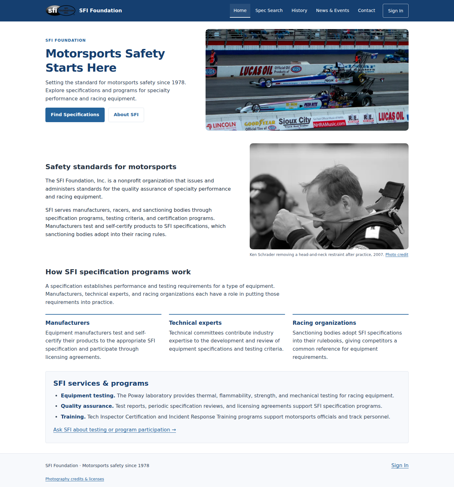
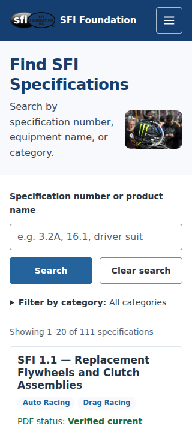

# Site photography — before and after

Baseline: `4bae7bd93`. The navbar is now logo/name/navigation only. The five photographs appear in the actual pages.

| Page | Desktop before | Desktop after | Mobile before | Mobile after |
| --- | --- | --- | --- | --- |
| Home (hero + safety) | [1440px](screenshots/before-home-1440.png) | [1440px](screenshots/after-home-1440.png) | [390px](screenshots/before-home-390.png) | [390px](screenshots/after-home-390.png) |
| Spec Search | [1440px](screenshots/before-specifications-1440.png) | [1440px](screenshots/after-specifications-1440.png) | [390px](screenshots/before-specifications-390.png) | [390px](screenshots/after-specifications-390.png) |
| History | [1440px](screenshots/before-history-1440.png) | [1440px](screenshots/after-history-1440.png) | [390px](screenshots/before-history-390.png) | [390px](screenshots/after-history-390.png) |
| News & Events | [1440px](screenshots/before-news-events-1440.png) | [1440px](screenshots/after-news-events-1440.png) | [390px](screenshots/before-news-events-390.png) | [390px](screenshots/after-news-events-390.png) |

After screenshots also cover 1024px, 768px, and 320px for all four pages. [Mobile navigation](screenshots/after-mobile-navigation-390.png). Spec Search screenshots show the first viewport; search results and pagination are exercised separately by the regression suite.

[Full source, license and implementation report](../SFI_SITE_PHOTOGRAPHY_REPORT.md). Photographs retain their original licenses; credits and sources are linked from the live page footer and recorded in the report.
