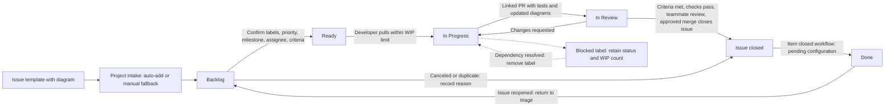
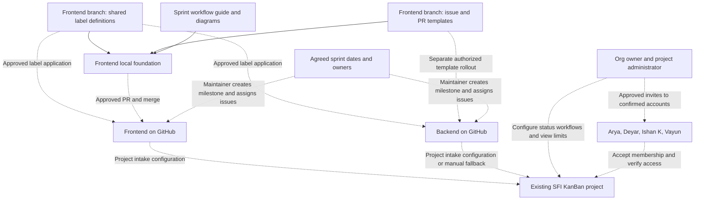

# Sprint workflow foundation — Frontend #8

This guide implements the repository-local foundation for
[issue #8](https://github.com/SFI-Foundation/Frontend/issues/8). The team uses
[Frontend](https://github.com/SFI-Foundation/Frontend) and
[Backend](https://github.com/SFI-Foundation/Backend) with one
[SFI KanBan project](https://github.com/orgs/SFI-Foundation/projects/1).

## Implementation status and scope

This change supplies one general-purpose [issue template](../.github/ISSUE_TEMPLATE/sprint-work.md),
a [PR template](../.github/pull_request_template.md), and reusable
[label definitions](../.github/labels.json) in Frontend. The issue template
includes Objective, Context, Tasks, Acceptance Criteria, Diagrams, and Related,
with a Mermaid starter present in every generated issue body. Contributors
must adapt it or supply a draw.io `.drawio.svg` diagram. This Markdown template
prompts for the diagram; reviewers check its relevance and completeness.

These files are prepared on a feature branch. GitHub's template picker uses
templates on the default branch, so availability there awaits an approved PR
and merge. No remote labels, milestones, issue assignments, project workflows,
invitations, or branch protection settings are configured by these files.
Backend adoption is pending a separately authorized change in that repository.
The issue's cross-repository and organization acceptance criteria remain open
until the manual checklist below is verified.

Reference: [GitHub's issue-template setup guide](https://docs.github.com/en/communities/using-templates-to-encourage-useful-issues-and-pull-requests/configuring-issue-templates-for-your-repository).

## Shared labels

`.github/labels.json` is the canonical reusable data file. Colors are six-digit
hex values without `#` in JSON. Apply the exact same names, colors, and
descriptions in **both Frontend and Backend**; `frontend` and `backend` are
lowercase label names, not separate capitalized aliases.

| Name | Hex color | Definition |
| --- | --- | --- |
| `frontend` | `#1D76DB` | Frontend pages, browser behavior, and client integration. |
| `backend` | `#5319E7` | Server APIs, persistence, and backend services. |
| `ml` | `#C2E0C6` | Machine learning models, inference, and data pipelines. |
| `ui` | `#D4C5F9` | Visual design, interaction, accessibility, and responsive layout. |
| `bug` | `#D73A4A` | Existing behavior differs from the intended behavior. |
| `docs` | `#0075CA` | Documentation, diagrams, and contributor guidance. |
| `blocked` | `#B60205` | Cannot proceed until a documented dependency or decision is resolved. |
| `P1` | `#B60205` | Highest priority: address first due to a critical impact or dependency. |
| `P2` | `#FBCA04` | Normal priority: planned work ordered within the sprint. |
| `P3` | `#0E8A16` | Lower priority: schedule after higher-priority commitments. |

Use applicable area/type labels together and exactly one priority label.
For `blocked`, link the dependency or decision and name the person coordinating
resolution after confirming ownership. Keep blocked work in its current column
and count it against that column's limit; remove the label when resolved.

After explicit approval, a repository maintainer can compare each repository's
**Issues → Labels** with the JSON, then create missing labels or edit matching
ones. Preserve unrelated labels; review any rename and its affected issues
before proceeding. The JSON is a data contract for future sync tooling, not an
installed GitHub Action or an automatically executed sync configuration.
Verify names, colors, and descriptions in both repositories after application.

## Sprint milestones and ownership

Repeat for each sprint only after the Scrum Masters confirm its number, dates,
goal, capacity, and responsible teammates. No dates or new assignments are
specified by this guide.

1. Agree on a title such as `Sprint <number>`, a start date, a due date, and a
   short goal. Record the start date and scope in the description; use the due
   date field for the agreed deadline.
2. With approval, open **Issues → Milestones** in each repository. Inspect
   existing milestones first; reuse the matching sprint or create it with
   **New milestone**. Match the title, description, and due date across both
   repositories. Milestone numbers/IDs are repository-specific; do not assume
   they match. See [GitHub's milestone guide](https://docs.github.com/en/issues/using-labels-and-milestones-to-track-work/creating-and-editing-milestones-for-issues-and-pull-requests).
3. Review `is:issue is:open` in both repositories with the team. For every open
   issue, confirm its objective, diagram, acceptance criteria, labels, one
   priority, responsible assignee, and agreed sprint milestone. Assign current
   work to `Sprint 1` only after its dates, capacity, and scope are confirmed;
   plan other work into agreed later sprints. Split oversized work with the
   team's agreement. Do not guess owners or silently move existing commitments.
4. Once those changes are approved, set assignees and milestones in the issue
   sidebar or use a carefully reviewed bulk selection. Verify the chosen
   accounts have accepted access. Record unresolved owner/date/scope decisions
   rather than claiming all issues are assigned.
5. In each repository, check `is:issue is:open no:milestone` and
   `is:issue is:open no:assignee`. Resolve every result with the team before
   declaring issue #8's assignment criterion complete. Confirm issues appear
   on the shared board and display the expected milestone and assignee.
6. During the sprint, check blocked work and capacity regularly. At review,
   verify completed work against acceptance criteria; explicitly agree on any
   carryover and its destination milestone. Close a sprint milestone after
   review, record carryover decisions, and repeat for the next agreed sprint.

## Kanban policy and GitHub Projects setup

The following are **proposed starting limits**, pending team approval and
configuration in the existing project. They assume the four developer roles
listed in the README; reassess when available capacity changes.

| Status | Proposed limit | Entry and exit policy |
| --- | --- | --- |
| Backlog | No numeric cap | Intake queue, not a sprint commitment. Triage weekly; remove the reported cap of 5 rather than dropping issues to fit it. |
| Ready | 8 issues across both repos | Objective, tasks, acceptance criteria, diagram, labels, priority, confirmed assignee, and milestone are complete; dependencies allow work to start. About two prepared issues per developer. |
| In Progress | 4 issues total; at most 1 per developer | Pull from Ready when capacity exists. Count blocked issues; finish or unblock work before starting more. |
| In Review | Team reviews daily | A linked PR is ready with test results and updated diagrams; return to In Progress for substantial revisions. |
| Done | No numeric cap | Issue is closed. Completed work meets acceptance criteria; canceled/duplicate work records a closure reason and is excluded from completed-work reporting. |

The `19/5` Backlog count is reported by issue #8, not a live board audit.
GitHub column limits are visual signals, not enforced gates, and apply per
view. A maintainer must set the column field to **Status**, expose the five
statuses above, set limits in each relevant shared board view, and save the
view. Use each column's menu → **Set column limit**; clear the Backlog limit
and set Ready to 8 and In Progress to 4. Review an unfiltered view covering both
repos when checking total WIP;
a sprint/assignee filter can hide work. See [GitHub's board configuration guide](https://docs.github.com/en/issues/planning-and-tracking-with-projects/customizing-views-in-your-project/customizing-the-board-layout).

After explicit approval, a project administrator should configure and verify:

1. **Workflows → Auto-add to project**: select Frontend and filter
   `is:issue is:open`. Add a second workflow for Backend with the same filter,
   if the organization's plan permits two auto-add workflows. GitHub Free
   currently permits one; if a second is unavailable, agree on a manual intake
   owner for the other repository and check for missing issues during triage.
   Do not claim fully automated intake until both repositories are covered.
2. **Item added to project**: set **Status → Backlog** and enable the workflow.
   Auto-add controls membership; this separate workflow sets the initial column.
3. **Item closed**: set **Status → Done** and enable the workflow for issues.
   Keep review completion distinct from closing a PR without merging. Move an
   issue to In Review manually when its PR is ready; a merged PR closes it via
   a valid `Closes #<number>` reference when merged to the default branch.
   Acceptance criteria, checks, and at least one teammate review are the team
   policy before an approved merge; these templates do not enforce branch rules.
4. Inspect **Item reopened** if available and route reopened issues to Backlog
   for triage. Otherwise move them manually and verify none remain in Done.
   Review overlapping workflows so they do not overwrite active issue statuses.
5. Add existing open issues manually after approval. Auto-add does not backfill
   existing matches when first enabled. Preserve each issue's actual progress
   if the initial Backlog workflow fires; reconcile statuses with its owner.
6. With approval for temporary test issues, verify a new issue from each repo
   enters Backlog, closing it moves it to Done, and reopening returns it to
   triage. If no test mutations are approved, observe the next authorized real
   issue events and record the results before marking automation verified.

These actions belong in the organization's GitHub Projects interface; no
project automation is installed by this repository change. Reference:
[auto-add workflows and plan limits](https://docs.github.com/en/issues/planning-and-tracking-with-projects/automating-your-project/adding-items-automatically)
and [built-in status workflows](https://docs.github.com/en/issues/planning-and-tracking-with-projects/automating-your-project/using-the-built-in-automations).

## Team invitations

Pending invitees: **Arya, Deyar, Ishan K, and Vayun**. The README lists profile
links, but these are not confirmation of the accounts to invite or evidence of
current organization membership. Confirm each GitHub username directly with
the teammate and check existing membership/pending invitations first.

After explicit approval, an organization owner should:

1. Open **SFI-Foundation → People → Invite member** and select the confirmed
   account or verified email. Check the selected profile before sending.
2. Use the **Member** organization role and the approved team. Confirm that
   team's intended access to Frontend, Backend, and the shared project;
   organization membership alone does not establish the desired permissions.
3. Send only the approved invitations. Track pending/accepted status without
   publishing private email addresses. Follow up through an approved channel.
4. After acceptance, verify repository/project access and that the account can
   be selected as an issue assignee. Assign work only after its owner agrees.

Reference: [GitHub's organization invitation guide](https://docs.github.com/en/organizations/managing-membership-in-your-organization/inviting-users-to-join-your-organization).

## Issue lifecycle

This is the proposed operating policy. Intake/closure automation below is
pending the project setup above; other transitions are manual team decisions.

## Project management architecture

Solid arrows show the local Frontend foundation. Dashed arrows identify
pending adoption or configuration; they do not assert remote setup is complete.

## Remaining manual acceptance checklist

- [ ] Approve, review, and merge the Frontend foundation through the normal PR process.
- [ ] Authorize a separate Backend change; inspect its conventions and adopt matching templates and label definitions without redundant templates.
- [ ] Approve and apply the shared labels in both repositories; verify exact names, colors, and descriptions.
- [ ] Confirm sprint numbers, dates, goals, capacity, and owners; create matching milestones with due dates in both repositories.
- [ ] Approve issue updates; verify every open issue has an agreed milestone and responsible assignee, including current Sprint 1 work.
- [ ] Approve board changes; configure statuses, view limits, intake, closure, and reopening behavior; reconcile existing items and verify both repos.
- [ ] Confirm four invitees' accounts and access; approve invitations, verify acceptance, and then confirm assignability.
- [ ] Record evidence of remote configuration and acceptance in issue #8 after approval; keep these diagrams current with actual automation and capacity decisions.

Until those steps are complete, report the repository foundation as prepared
and the organization rollout as pending. Do not mark issue #8 fully accepted.
