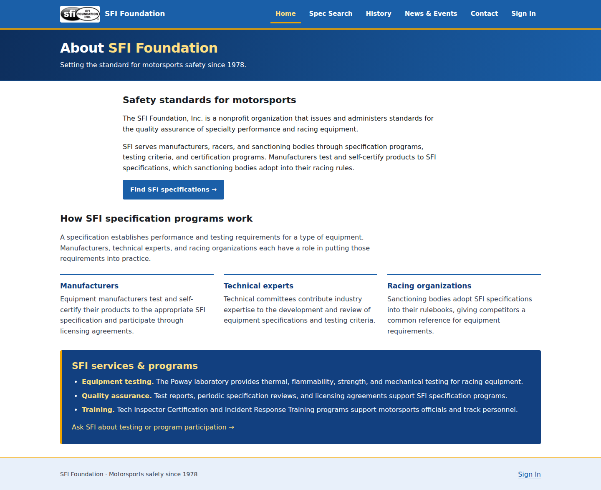
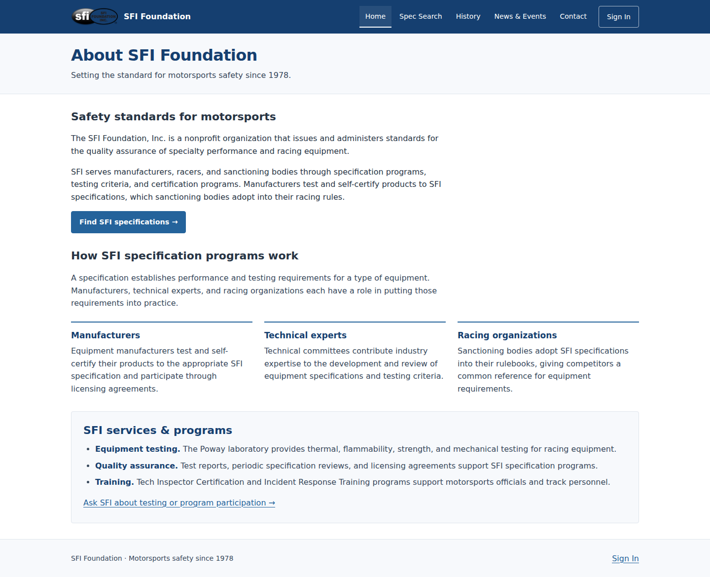
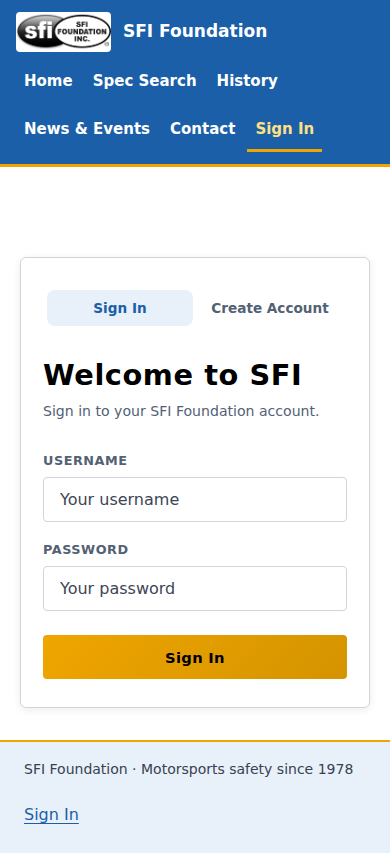
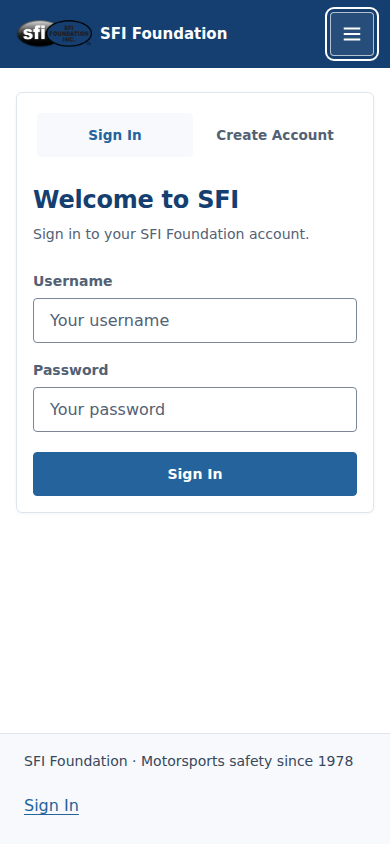

# SFI UI polish — visual comparisons

Before: feature baseline `10e95f0c6`. After: `feature/sfi-final-ui-polish`. These are actual Chromium captures, with existing page content and specification records preserved.

| Page | Desktop before | Desktop after | Mobile before | Mobile after |
| --- | --- | --- | --- | --- |
| Home | [1440px](screenshots/before-home-1440.png) | [1440px](screenshots/after-home-1440.png) | [390px](screenshots/before-home-390.png) | [390px](screenshots/after-home-390.png) |
| Spec Search | [1440px](screenshots/before-specifications-1440.png) | [1440px](screenshots/after-specifications-1440.png) | [390px](screenshots/before-specifications-390.png) | [390px](screenshots/after-specifications-390.png) |
| History | [1440px](screenshots/before-history-1440.png) | [1440px](screenshots/after-history-1440.png) | [390px](screenshots/before-history-390.png) | [390px](screenshots/after-history-390.png) |
| News & Events | [1440px](screenshots/before-news-events-1440.png) | [1440px](screenshots/after-news-events-1440.png) | [390px](screenshots/before-news-events-390.png) | [390px](screenshots/after-news-events-390.png) |
| Contact | [1440px](screenshots/before-contact-1440.png) | [1440px](screenshots/after-contact-1440.png) | [390px](screenshots/before-contact-390.png) | [390px](screenshots/after-contact-390.png) |
| Sign In | [1440px](screenshots/before-sign-in-1440.png) | [1440px](screenshots/after-sign-in-1440.png) | [390px](screenshots/before-sign-in-390.png) | [390px](screenshots/after-sign-in-390.png) |
| Create Account | [1440px](screenshots/before-create-account-1440.png) | [1440px](screenshots/after-create-account-1440.png) | [390px](screenshots/before-create-account-390.png) | [390px](screenshots/after-create-account-390.png) |

After captures also cover 1024px, 768px, and 320px for every view. The [browser results](browser-results.json) list the captures and layout dimensions.

| Home before | Home after |
| --- | --- |
|  |  |

| Sign In before | Sign In after |
| --- | --- |
|  |  |

[Open mobile navigation and keyboard focus](screenshots/after-mobile-navigation-viewport.png) · [Sign In validation](screenshots/after-sign-in-error-390.png) · [Create Account validation](screenshots/after-create-account-error-390.png) · [Simulated success feedback](screenshots/after-create-account-success-390.png).

Authentication success feedback uses stubbed responses for visual capture; real authentication is separately tested against Flask and disposable SQLite. Main catalog screenshots use a local catalog with 111 canonical records. Gold is retained as a token, with no decorative gold added to compensate for its removal elsewhere.
